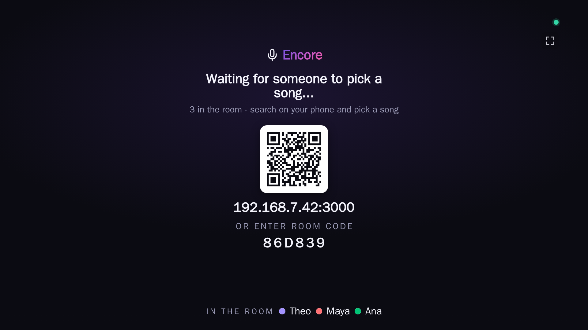
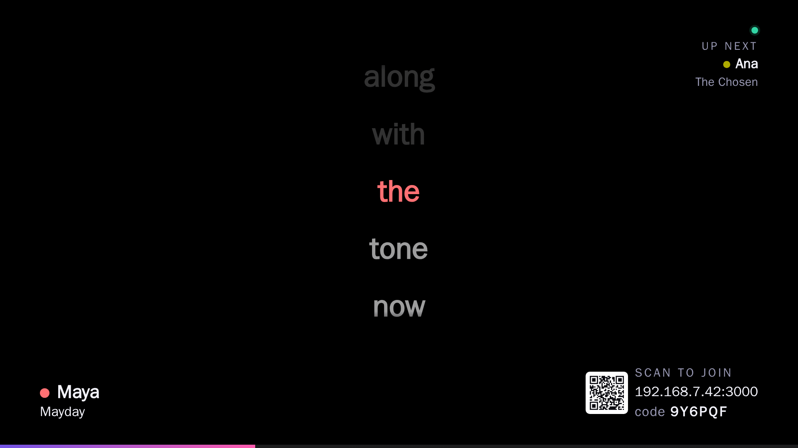
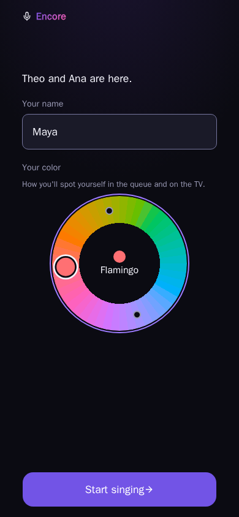
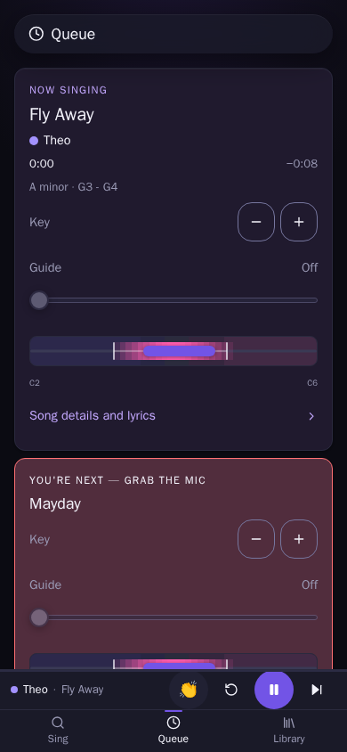

# 🎤 Encore

Self-hosted karaoke for a room full of phones. Scan a QR, queue anything from YouTube or your own
library, and sing — Encore strips the vocals itself, times the words to the music, and keeps the
rotation fair. One container to run it; a second if you want it making karaoke tracks for you.

| The TV, waiting for a pick | The TV, mid-song |
|---|---|
|  |  |

| Joining from a phone | The queue, with you on deck |
|---|---|
|  |  |

These frames come from [`core/tests/playwright/specs/shot/readme.spec.ts`](core/tests/playwright/specs/shot/readme.spec.ts), with 320 px
phone variants beside them in [`docs/screenshots/`](docs/screenshots/). Every other surface has a capture recipe in
[`core/tests/playwright/specs/shot/frames.spec.ts`](core/tests/playwright/specs/shot/frames.spec.ts), which drives the
real app into each state and writes the frame set under `core/tests/playwright/.artifacts/` (`bun run pw:shot`). Those
frames are generated rather than committed, so regenerate them locally when you want to look. Design and rationale live in
[`docs/ARCHITECTURE.md`](docs/ARCHITECTURE.md).

## Quickstart

**Docker:**

```bash
cp docker/.env.example docker/.env     # then set ENCORE_WORKER_TOKEN in it (see Security)
./dev.sh compose up                    # core only, on http://localhost:3000
./dev.sh compose --stems up            # core + the worker that makes karaoke tracks
./dev.sh compose --cuda --stems up -d  # the same on an NVIDIA box
```

`docker/.env` is optional (every value in it has a default), and the worker token belongs there. Both run
modes read it: a native `bash dev.sh` run loads all of it, and under Docker `docker/compose.yaml` passes
each service the settings from it that the service uses. In-container paths (data, media, binaries),
`PORT` and `HOST` are fixed by the image and compose, so under Docker you move the data with
`ENCORE_DATA_VOLUME` and `ENCORE_MEDIA_VOLUME` (the host directories mounted there) rather than
`DATA_DIR` and `MEDIA_DIR`, and change where core listens in compose's `ports:` line (see Security). `--stems` and `--cuda` are
`dev.sh` shorthand for `--profile stems` and the `docker/compose.cuda.yaml` override; everything else after
`compose` is handed to `docker compose` verbatim. The wrapper exists because the compose file lives in
[`docker/`](docker/) alongside both Dockerfiles and `.env`, so the equivalent by hand is
`docker compose -f docker/compose.yaml …` — and a forgotten `-f` acts on nothing rather than failing.

> **Run with `--stems` if you want songs made into karaoke.** Core accepts the request
> happily and then leaves it at `queued` **forever**, because stem separation happens in the worker —
> a separate process. There is no error on screen; the song just never processes. This is the single most
> common first-run surprise.

**Local dev (Bun ≥ 1.3).** The TypeScript project lives in `core/`, with its own `package.json`:

```bash
cd core
bun install                        # uses public npm via core/.npmrc
bun run build && bun run start     # prod build, served on :3000
# or: bun run dev                  # vite dev server — UI HMR only, no realtime (see below)
```

`core/data/` and `core/media/` are created on first boot and migrations apply automatically, so there is no
separate migrate step. `ENCORE_EPHEMERAL=1` gives an in-memory DB that leaves nothing behind.

Then open **`/tv`** on the television, and **scan the QR** with phones.

> **Phones need the host's LAN IP, not `localhost`** — e.g. `http://192.168.1.20:3000/tv`. The QR
> encodes the right address automatically, and if it can't, the TV says so on screen instead of
> showing a QR that goes nowhere. Deploying on Windows with an NVIDIA GPU? Read
> [`docs/deploy/WSL2.md`](docs/deploy/WSL2.md) first — WSL2's NAT is exactly the case that breaks this.

> ⚠️ **The TV is the exception: on a plain `http://<LAN-IP>` origin it silently loses ±key transpose.**
> The transpose runs through an `AudioWorklet`, which browsers only expose in a **secure context** —
> `https://` or the `localhost` family. The buttons still move and the sounding-key label still updates;
> the audio just never changes, and nothing is logged. The guiding track does not use the worklet, so it
> is unaffected, and so are phones (they run no audio DSP). If the display is driven by the
> Encore host, open `http://localhost:3000/tv` on it; the QR shows its home-network address. Otherwise see
> **[`docs/deploy/README.md`](docs/deploy/README.md)** for the four ways to get a secure context,
> cheapest first.

> Prefer `bun run start` (→ `server.ts`) over the adapter's `build/index.js`. `server.ts` owns **both**
> the SvelteKit handler and the WebSocket hub in one process; serving `build/index.js` directly gives
> you a UI with no realtime at all. `vite preview` has the same defect — it answers 200 on `/` and 404s
> `/health`, so the screen looks right while the queue never moves — which is why there is no
> `preview` script.

### The process worker

You can also run the worker natively instead of in Docker. It is a [uv](https://docs.astral.sh/uv/)
project, so install uv first (`brew install uv`, `pipx install uv`, or the installer on that page):

```bash
cd worker
# torch + demucs + whisperx and the separator zoo (multi-GB). Swap `cpu` for `cu128` on NVIDIA; dev.sh also
# adds `mlx`, which installs only on Apple Silicon.
uv sync --frozen --extra cpu --extra ml --extra text --extra ffmpeg --extra audiosep --extra romanize --extra nonlatin

# ENCORE_WORKER_TOKEN must be the same value core was started with; leave it empty only if core's is unset.
ENCORE_CORE_URL='ws://localhost:3000/ws?role=worker' \
  ENCORE_MEDIA_DIR="$PWD/../core/media" \
  ENCORE_WORKER_TOKEN="${ENCORE_WORKER_TOKEN:-}" \
uv run python -m encore_worker                         # uv run puts .venv/bin on PATH for python/yt-dlp
```

Those three variables are the whole configuration (the token only when core sets one, which the
Security section below says it should). The worker measures the rest and prints what it found at startup:
the accelerator, the device, the separator backend and the **capabilities** it can prove (`fetch:ytdlp`,
`stems`, `stems:roformer`, `stems:audiosep`, `align`, …), each gated on the tool actually being
installed. A box that proves none says so in a warning, because that line is what explains a song stuck at
0%. What each capability gate checks is in [`docs/arch/05-worker.md`](docs/arch/05-worker.md) §9.

The worker **dials home** to core, never the reverse. It runs `yt-dlp` and the separator CLIs **by name
via PATH** (torch demucs as `python -m demucs.separate`), hence `uv run` above, and capabilities are probed
against PATH too. ffmpeg prefers the static build the `ffmpeg` extra bundles. `ENCORE_MEDIA_DIR` must point
at the _same_ directory core is using, or core will mark a job complete for a file it cannot serve.
`ENCORE_WORKER_CONCURRENCY` (default `1`) sets how many jobs run at once.

A native worker also needs a **JavaScript runtime on PATH — install `deno`.** YouTube's player
challenge (the signature and `n` parameters) cannot be solved without one, and yt-dlp needs its solver
enabled via `--remote-components ejs:github`. Miss either and extraction degrades silently until no
audio-only format resolves at all, so every process fails at download with `Requested format is not
available` — which reads as a broken worker rather than a missing dependency. The worker image ships
`deno` plus `/etc/yt-dlp.conf`; a hand-rolled native run has neither, so install `deno` and either copy
`docker/yt-dlp.conf` to `/etc/yt-dlp.conf` or point yt-dlp at it with `--config-location`.

**`dev.sh` handles both halves for you.** It writes `docker/yt-dlp.conf` into a scratch
`XDG_CONFIG_HOME` the worker alone sees — so the solver is enabled without touching `/etc` or your own
`~/.config` — and if `deno` is not already on PATH it fetches the same pinned release
`docker/worker.Dockerfile` installs, into `worker/.dev-tools/bin`. The download is **sha256-verified against
the checksum the release publishes** before it is made executable, nothing is installed system-wide, a
system `deno` always wins, and `ENCORE_SKIP_DENO=1` opts out. Note that **node, bun and quickjs do not
substitute**: yt-dlp supports them but enables only `deno` by default, so a box with node and no deno
fails every download.

Separately: **not every YouTube video will download.** Upstream bot-checking rejects some, so a handful
of failed processes on specific videos is not a broken install.

## What it does

- **Phone remote** — scan to join (a name and a colour off a colour ring, no signup), then three tabs:
  **Sing** (one search box over YouTube and your library, ordered by whether you can sing it _now_, with
  one-tap queue), **Queue** (`/queue`: the rotation, drag-reorder, remove with undo, now-playing
  transport) and **Library** (`/library`: the songs already made, filtered in place).
- **Your turn** — while the song before yours plays, an **On deck** card on the Queue tab sets the key
  and guide your song will start in, and offers **Not yet** once to let the next singer go first. When
  the TV shows the "Now singing" card for you, your phone says **You're up**, on any tab.
- **Reactions** — phones send cheers from the now-playing strip, and the TV floats them up the side of
  the stage.
- **TV stage** — four room states (attract → lobby → waiting → playing), gapless two-player video, a
  "Now singing" card, and a song-intro card between turns. One TV per room: a second screen that opens
  `/tv` offers **Make this the TV** instead of fighting the first.
- **Making karaoke** — one tap on any YouTube result takes a turn and starts the worker stripping the
  vocals. The singer keeps their place in line while it works, and the card shows real progress and the
  time left, estimated from past jobs. The separator is a setting: Demucs, BS-RoFormer or the
  `audio-separator` model zoo. On Apple Silicon, with `demucs-mlx` installed, the worker runs
  Demucs through it (the `mlx` backend).
- **Word-timed lyrics** — the worker gathers every candidate sheet (LRCLIB, LRCmux, the video's own
  captions, and a Whisper transcript of the vocals stem), force-aligns each one against the vocals
  stem, and keeps the words that are actually sung, so "Telephone (feat. Beyoncé)" stops singing the
  lyrics of "Telephone". Words it had to transcribe itself are labelled as such on screen. Marker,
  highlight, size, font, case and row counts are all room settings. How the grading works:
  [`docs/ARCHITECTURE.md`](docs/ARCHITECTURE.md) §8 and [`docs/arch/04-alignment.md`](docs/arch/04-alignment.md).
- **Guiding track** — fade the original singer back in, quietly, for a song you don't quite know.
  Per song, with a room default.
- **Key shift** — ± semitone in the browser, with the sounding key and the range the song demands
  updating as you move it.
- **Karaoke library** — processed songs persist in a self-describing media volume, browsable by artist
  and tag.
- **House rules** — fair rotation (the default: everyone's 1st pick before anyone's 2nd), first come
  first served, shuffle, whoever sang longest ago, or a manual order you drag. A room setting, so
  changing it re-orders what's waiting instantly and never interrupts what's playing.
- **Settings in three scopes** — `/settings` is this room's (turns, the TV, lyrics on the TV, sound),
  `/settings/server` is the machine's (making karaoke, the lyrics engine, joining), and `/settings/you` is
  your name and colour. `/admin` deletes a song from the library for good, after a confirm step.
- **Stage look** — black (the default), room glow, the singer's colour, a fixed colour, or an audio
  visualizer (plasma, starfield, ripples, phase curves). Every option is pinned dark so the lyrics
  stay readable. There are deliberately no spectrum bars: the TV does not listen to the audio, so they
  would only be pretending. Why: [`docs/ARCHITECTURE.md`](docs/ARCHITECTURE.md) §4.
- **Stats and audit** — `/stats` is public and aggregate-only (library size, most-sung, top artists,
  sings per day). `/metrics` is internal: time per pipeline step with queue wait separated out,
  end-to-end per process, and cost per model measured against the model's own declared `rtFactor`. Any
  song links to `/metrics/<mediaId>` — every run, every retry, which model ran it, and why it failed.
- **Real-time and optimistic** — every tap renders instantly, twenty phones stay in sync over flaky
  wifi, and reconnects self-heal.

## Security

> ⚠️ **Encore has no operator identity. Treat it as trusted-LAN-only software.**
>
> - Any device that can reach the port can join as a singer, and **any joined phone can `PUT
>   /api/settings`** — which includes the separator engine and which Whisper weights the fleet loads —
>   and can delete a song from the library for good (`/admin`).
> - **Set `ENCORE_WORKER_TOKEN`.** Without it, `role=worker` WebSocket upgrades are unauthenticated:
>   anything that can reach the port can register as a worker and start receiving job assignments.
>   Core logs one loud warning at startup when it is unset. The token travels in **cleartext**, as the
>   `token=` query of a plain `ws://` URL: it keeps stray LAN devices out, not anyone who can watch
>   the LAN's traffic. It is for a trusted LAN only.
> - `/metrics` and `/api/audit/*` are **ungated** — they expose worker ids, host details, model names,
>   file paths and error strings (no singer identities and no media bytes).
>
> Bind to a trusted interface or put it behind a gateway. Run natively, `HOST=127.0.0.1` keeps it off the
> network entirely. **Under Docker, `HOST` and `PORT` do nothing**: compose sets `PORT=3000`, passes no
> `HOST`, and publishes `"3000:3000"` on every host interface. To keep a Docker install off the network,
> publish on loopback with a local override file, for example `docker/compose.local.yaml`:
>
> ```yaml
> services:
>   core:
>     ports: !override ["127.0.0.1:3000:3000"]
> ```
>
> and pass it as a second file: `./dev.sh compose -f docker/compose.local.yaml up` (`!override` needs
> Docker Compose 2.24 or later). Do not expose the port to a network you don't trust. The boundaries are written down in
> [`docs/ARCHITECTURE.md`](docs/ARCHITECTURE.md) §10.

## Stack

**Bun** runtime · **SvelteKit + Svelte 5 (PWA)** · **`Bun.serve` native WebSocket pub/sub** ·
**`bun:sqlite` (WAL) + Drizzle** · in-memory authoritative state · bundled **yt-dlp + ffmpeg**. One
container for core; a Python worker (separators, forced alignment, Whisper, durable jobs on **DBOS**)
joins as container 2 for stems.

> **YouTube search** uses keyless `yt-dlp`, bundled in the Docker image. Core invokes it **by name via
> PATH**, so in bare local dev without `yt-dlp` installed YouTube search silently returns empty — no
> error, just no results — while the library keeps working. `brew install yt-dlp`, or launch core with
> the worker venv's `bin` on PATH.

## Layout

```
core/                 ← Container 1: the TypeScript project (own package.json, bun.lock, node_modules)
  server.ts           Container 1's entry: Bun.serve, HTTP + native WS pub/sub hub, ONE process
  src/lib/contract/   the realtime contract, made physical — imported by client, server AND worker
  src/lib/server/     authoritative backend (state, rotation, playback, jobs, media, db)
  src/lib/            client: optimistic store, ws client, components, TV gapless controller
  src/routes/         phone (+page = Sing, /queue, /library), /tv, /settings, /admin, /stats,
                      /metrics, /song, /api
  tests/              unit/ (bun) + playwright/ (Chromium: gate | flow | probe | shot)
  config/ drizzle/    drizzle + knip configs; migrations
worker/               ← Container 2: Python stems/align (dials home; `--profile stems`)
docker/               ← both Dockerfiles, compose files and .env.example
docs/                 ← the written record; see the index below
.github/workflows/    ← CI definitions (see Testing and CI)
LICENSE  CREDITS.md   ← PolyForm Noncommercial 1.0.0; third-party material (code and media)
```

### The documents

| Document                                  | What it holds                                                                   |
| ----------------------------------------- | ------------------------------------------------------------------------------- |
| [`ARCHITECTURE.md`](docs/ARCHITECTURE.md) | how the system works, as a narrative: authority, rotation, media, jobs, lyrics  |
| [`LAYOUT.md`](docs/LAYOUT.md)             | where a file goes, and what may not move                                        |
| [`FRONTEND.md`](docs/FRONTEND.md)         | the rules a UI change must respect — styling, runes, components, routes, the TV |
| [`SERVER.md`](docs/SERVER.md)             | the same for the server, the shared contract, the job pipeline and the worker   |
| [`TESTS.md`](docs/TESTS.md)               | the two test rungs, what each can honestly decide, and what was cut             |
| [`E2E.md`](docs/E2E.md)                   | the browser harness, the selector contract, and what each probe proves          |
| [`UI-TENETS.md`](docs/UI-TENETS.md)       | the seven UI tenets in priority order, and the speed budget for each moment     |
| [`UI-DESIGN.md`](docs/UI-DESIGN.md)       | the visual rules: control contrast, the spacing and type ladders, one look each |
| [`UI-CHECKLIST.md`](docs/UI-CHECKLIST.md) | what a UI PR is checked against: the motion frames and the tenet checks         |
| [`arch/`](docs/arch/README.md)            | subsystem contracts as numbered requirements a machine can often check          |
| [`deploy/`](docs/deploy/README.md)        | getting a secure context, and the WSL2 case that breaks it                      |
| [`benchmarks/`](docs/benchmarks/)         | the stem-separation and forced-alignment measurements, and how to rerun them    |

`FRONTEND.md`, `SERVER.md`, `TESTS.md` and `E2E.md` exist so the source can state a rule in one line and
point at the reasoning, instead of carrying the reasoning inline. A rule that outlives one file belongs in
one of them.

## Configuration

**Core**

| Env                      | Default      | Purpose                                                                                                                                                                                                                                                                                                                                                   |
| ------------------------ | ------------ | --------------------------------------------------------------------------------------------------------------------------------------------------------------------------------------------------------------------------------------------------------------------------------------------------------------------------------------------------------- |
| `PORT`                   | `3000`       | HTTP + WS port                                                                                                                                                                                                                                                                                                                                            |
| `HOST`                   | `0.0.0.0`    | bind address (use `127.0.0.1` to keep it off the network)                                                                                                                                                                                                                                                                                                 |
| `ENCORE_WORKER_TOKEN`    | unset        | shared secret required on `role=worker` WS upgrades; a worker without a matching `token` gets `401`. **Unset means worker registration is unauthenticated** — see Security                                                                                                                                                                                |
| `ENCORE_PUBLIC_ORIGIN`   | unset        | address the TV's join QR advertises, e.g. `http://192.168.1.20:3000`. Unset = derive from the request. Set it when the machine showing `/tv` cannot reach its own public address (a WSL2 host, or a proxy that forwards no `X-Forwarded-*`). This is the _boot-time_ declaration; **Joining** in `/settings/server` overrides it at runtime with no restart |
| `DATA_DIR`               | `./data`     | SQLite (WAL) location — created if missing                                                                                                                                                                                                                                                                                                                |
| `MEDIA_DIR`              | `./media`    | root of the media volume — created if missing                                                                                                                                                                                                                                                                                                             |
| `MEDIA_STORE`            | `local`      | `local` volume or `object` (MinIO/S3, for remote workers)                                                                                                                                                                                                                                                                                                 |
| `ENCORE_SONG_INTRO_MS`   | seeds `2500` | song-intro card duration, seeded into the room on **first boot only** (`0` seeds it off, for a pure gapless hard-cut). `INTERSTITIAL_MS` is still read as a deprecated alias. Both the duration and the on/off toggle live in the room's `/settings` afterwards                                                                                             |
| `ENCORE_LYRICS_BACKFILL` | on           | set `0` to skip the boot-time lyrics backfill for already-processed songs                                                                                                                                                                                                                                                                                 |
| `ENCORE_VOCALS_BACKFILL` | on           | set `0` to skip the boot-time guiding-track (vocals stem) backfill                                                                                                                                                                                                                                                                                        |
| `ENCORE_EPHEMERAL`       | unset        | `1` → in-memory DB; nothing persists (handy for a throwaway instance)                                                                                                                                                                                                                                                                                     |
| `FFMPEG_BIN`             | `ffmpeg`     | ffmpeg binary core uses to recompress, and to probe a song's duration and loudness (without a usable one, a silent stem cannot be detected) |
| `SPOTIFY_CLIENT_ID`, `SPOTIFY_CLIENT_SECRET` | unset | both set adds Spotify tracks to search results; a Spotify result is never processed. Either unset = no Spotify, no error |
| `ENCORE_PUBLISH_STEM_FORMAT` | `flac` | the container published stems are stored in. Core announces it to every worker at handshake; it applies to new songs only |

**Storage classes** — split by _replaceability_ so they can live on different volumes (see
[`docs/ARCHITECTURE.md`](docs/ARCHITECTURE.md) §6). Each defaults under `MEDIA_DIR`.

| Env                   | Default              | Holds                                                                                                                                                                              |
| --------------------- | -------------------- | ---------------------------------------------------------------------------------------------------------------------------------------------------------------------------------- |
| `ENCORE_AUDIO_DIR`    | `$MEDIA_DIR/audio`   | raw originals — **not regenerable; back this up**                                                                                                                                  |
| `ENCORE_DERIVED_DIR`  | `$MEDIA_DIR/derived` | stems, the guide mix, lyrics, thumbs — safe to delete                                                                                                                              |
| `ENCORE_META_DIR`     | `$MEDIA_DIR/meta`    | sidecar records — the authoritative library index                                                                                                                                  |
| `ENCORE_MEDIA_MAX_GB` | unset                | soft cap; evicts `derived/` LRU-first. Unset = never delete. Every song's guide mix costs about as much again as its stems, so size the cap for that — eviction is whole-song |

**Object store** (only when `MEDIA_STORE=object`) — `S3_BUCKET` (required), `S3_ENDPOINT`,
`S3_REGION`, `S3_PREFIX`. Credentials come from the standard `AWS_*` env vars, which `Bun.S3Client`
reads directly. A missing bucket falls back to `local` rather than failing to boot.

**Worker** — two settings, and everything else is measured. Every variable below except `ENCORE_ANNOTATE`
is read in one place, [`worker/encore_worker/host/config.py`](worker/encore_worker/host/config.py), and a
malformed value (an unknown backend, ASR model or experiment, a non-number where a number goes) stops the
worker at startup with a message naming the variable and what it accepts. `ENCORE_ANNOTATE` is read by
`adapters/musicbrainz.py` instead, and is not validated.

| Env                | Purpose                                                                           |
| ------------------ | --------------------------------------------------------------------------------- |
| `ENCORE_CORE_URL`  | where core is, as `ws://<host>:3000/ws?role=worker`. No probe can guess this      |
| `ENCORE_MEDIA_DIR` | the volume core is also using. Must match, or core serves a file that isn't there |

Everything else is an **override**, with a default that suits one worker beside one core:

- **Placement** — `ENCORE_WORKER_TOKEN` (must match core's), `ENCORE_WORKER_ID` (`worker-` plus a stable suffix; unique per worker),
  `ENCORE_WORKER_CONCURRENCY` (`1`; separation and alignment are both GPU-bound)
- **Device** — `ENCORE_DEVICE` (unset = CUDA, then Apple MPS, then CPU, as torch finds them; otherwise a
  torch device string such as `cuda:1` or `xpu`), `ENCORE_SEPARATOR_BACKEND` (`torch` or `mlx`; unset picks
  `mlx` on Apple Silicon when `demucs-mlx` is installed)
- **Separation** — `ENCORE_FLAC_LEVEL` (`8`), `ENCORE_ZOO_MODEL_DIR` (where the `audio-separator` zoo
  caches its 100–400 MB checkpoints; defaults to `$XDG_CACHE_HOME/encore-worker/separator-models`, which the
  Docker image keeps on a named volume), `ENCORE_PUBLISH_STEM_FORMAT` (`flac`; a fallback only, since core
  announces the real value at handshake)
- **Lyrics and metadata** — `ENCORE_ASR_MODEL` (`base`; one of `tiny`, `base`, `small`, `medium`,
  `large-v2`, `large-v3`, and only a fallback for a job that names none), `ENCORE_ALIGN_MODEL` (the
  English alignment bundle; unset = this device's default), `ENCORE_LRCMUX_URL` and `ENCORE_LRCLIB_URL`
  (the two lyrics providers, both self-hostable), `ENCORE_HTTPS_PROXY` (for those lookups; unset falls back
  to the standard proxy variables), `ENCORE_OFFLINE` (`1` skips the providers instead of paying their
  timeout per song; captions and Whisper still work), `ENCORE_ANNOTATE` (`1`; `0`, `false` or `no`
  turns off MusicBrainz lookups, and any other value leaves them on)
- **Jobs** — `ENCORE_DBOS_DB` (`encore-worker.sqlite`; the durable job state, per box, never shared),
  `ENCORE_JOB_CEILING_SEC` (`21600`; the backstop for a job nothing else can stop),
  `ENCORE_KEEPALIVE_SEC` (`10`; must stay well under core's 30 s progress lease)
- **Binaries** — `ENCORE_FFMPEG_BIN` (unset = the best ffmpeg available, the bundled static build
  first), `ENCORE_YTDLP_BIN` (`yt-dlp`), `ENCORE_MLX_BIN` (`demucs-mlx`)
- **Benchmarking** — `ENCORE_ALIGN_EXPERIMENTS` (a comma-separated list of alignment arms to switch on;
  what each one does is in [`docs/arch/04-alignment.md`](docs/arch/04-alignment.md) §14)

What the worker measures for itself at startup: the **accelerator** and its name, the **separator
backend**, which **ffmpeg** it will use, the English **alignment bundle**, the **non-Latin routes** it can
honour, and the **capabilities** it can prove. It prints each one, so the startup log is the first place to
look when a song never processes.

Two things that look like env vars but are **settings**, so they change with no restart: the **lyrics
engine** (which Whisper checkpoint reads the words, and whether timings are per-word or per-line) is set in
`/settings/server` and rides on every `align` job; the **stage look**, **house rule**, **TV progress
placement** and every **lyrics presentation** option are per-room, in `/settings`.

## Status & roadmap

**Done:** the realtime spine (join, phone remote, search, gapless TV, room states + presence); making
karaoke on a durable worker, with Demucs, BS-RoFormer and the `audio-separator` zoo to pick from and real
progress and time left on every card; word-timed lyrics graded across every candidate sheet, with
provenance labels and romanised lanes for non-Latin scripts; the saved library, readiness search, media
storage classes, browse and retention; stats and audit dashboards; browser pitch-shift so ±key actually
transposes, the guiding track, and the song profile (detected key and the vocal range a song demands);
and the turn itself: On deck, the "Now singing" handoff with You're up, room reactions, and one TV per
room.

**Next:** hot-titles persistence, and accounts + multi-room. Open work is tracked in
[GitHub issues](https://github.com/OnlyOneByte/Encore/issues).

## Dev notes

```bash
bash dev.sh       # run core + a NATIVE worker locally — `--help` lists the flags, including
                  # --core-only, --ui, --reset and --fresh. On a Mac this is the only way to get
                  # Metal: see docs/deploy/README.md for why a containerised worker cannot.

cd core           # every bun command below runs from core/
bun run test      # unit/integration tests (a plain bun test)
bun run check     # svelte-check + types, 0 errors
bun run typecheck # app, server entry and the test tree
bun run lint      # eslint; `bun run format:check` is prettier
bun run gates     # the full eight-leg release gate (test, worker pytest, worker ruff+mypy, types, lint, format,
                  # build, gate:measured). The last leg needs a Chromium.
bun run deadcode  # knip; a clean run is ZERO findings
bun run pw        # the whole Chromium suite — needs a built app (`gate:measured`, `pw:flow|probe|shot` for one project)
bun run ui:review # motion frames + GIFs for a UI change, checked against docs/UI-CHECKLIST.md

# Worker — uv owns the env; `uv run` syncs it before it runs anything:
cd worker && uv python install 3.12   # .python-version pins it; uv fetches the interpreter
uv run pytest -q -m "not ml"  # the fast worker suite (asyncio_mode=auto): no torch, no models
uv run ruff check .          # lint (pyflakes/pycodestyle/isort/bugbear/pyupgrade/tidy-imports)
uv run ruff format --check . # format gate (ruff is the formatter; no separate black)
uv run mypy                  # type-check encore_worker/ and tests/ (config in pyproject.toml)
```

`pyproject.toml` pins the worker's tooling in the PEP 735 `dev` group (pytest, pytest-asyncio,
pytest-timeout, ruff, mypy) and `uv.lock` holds the resolution, so the gates above reproduce from the
repo alone. `[tool.pytest.ini_options]` sets `asyncio_mode = auto`, so without **`pytest-asyncio`** the
async tests are silently skipped as un-awaited coroutines rather than failing.

**The pytest leg needs no `ml` extra.** A plain `uv sync` installs the base dependencies plus the `dev`
group, which carries the `ml` extra's light half (soundfile, scipy, pyloudnorm, cmudict, pyphen) and no
torch. On that install `pytest -m "not ml"` runs with no model downloads; the DBOS tests skip where the
system SQLite is older than 3.42 (Debian bookworm's is). The alignment tests reach whisperx through one
seam, `ml.load_audio_mono_16k`, and
`tests/conftest.py` stands in for it when whisperx is absent. The skips each name what the box lacks: the
real model stack (whisperx, torch, pyannote), a runnable ffmpeg (the `ffmpeg` extra or one on PATH), or a
SQLite new enough for DBOS (3.42). `uv run --extra ml pytest -q` still runs everything, where the torch
wheels install (x86_64 Linux, macOS). `ruff check`, `ruff format --check` and `mypy` all exit 0 on a clean
tree; any non-zero exit is a real finding.

- `tests/playwright/world/selectors.ts` is the **selector contract**: one declaration of every hook the
  browser specs drive. No spec may spell a selector for itself, because a hand-written one rots in
  silence — three selector families moved at once while the suite stayed green, which is why the
  registry exists. `tests/unit/playwright/selectors-exist.test.ts` fails when a class or data/aria hook a
  selector names is in no file under `src/`. It checks existence only, not that the hook is on the surface
  the spec opens, so a hook that moved to another route still only shows up when a spec opens the page.
- `tests/playwright/specs/flow/party.spec.ts` — the full two-phone + TV flow.
- `tests/playwright/specs/shot/frames.spec.ts` — the frame set, each frame DRIVEN into its state rather
  than photographed as it loads. `bun run pw:shot`.
- Every UI surface is eyes-on verified rather than assumed from a passing test.
- A green suite is the floor, not the bar — several real defects here were invisible to passing tests
  and only surfaced by driving the app.

## Testing and CI

**The bar for a change is the local gate run**, not GitHub: `bun run gates` (or its legs one by one, as
above) on the exact commit, with no new failures against `main`. A UI change also carries its phone and TV
frames, and `bun run ui:review` GIFs for anything that moves.

[`.github/workflows/`](.github/workflows/) holds four workflow definitions: `ci.yml` (core) and
`ci-worker.yml` (worker) on pull requests, plus a daily `nightly.yml` and a twice-monthly `ml.yml`. They
exist but are **not a gate**: they still trigger, but the repository has no Actions minutes (by the owner's
choice), so they fail within seconds. A red or missing check on a PR is not a verdict on it.

## License

Encore is **source-available, not open source**: it is licensed under the
[PolyForm Noncommercial License 1.0.0](LICENSE), which allows any non-commercial use, including changing
and sharing it, and does not allow commercial use. Third-party material (code and media) keeps its own
licence: the vendored shadcn-svelte components, the Lucide icon geometry, the benchmark songs and the
reaction artwork are all credited in [`CREDITS.md`](CREDITS.md), along with the MMS_FA model weights the
worker downloads.
