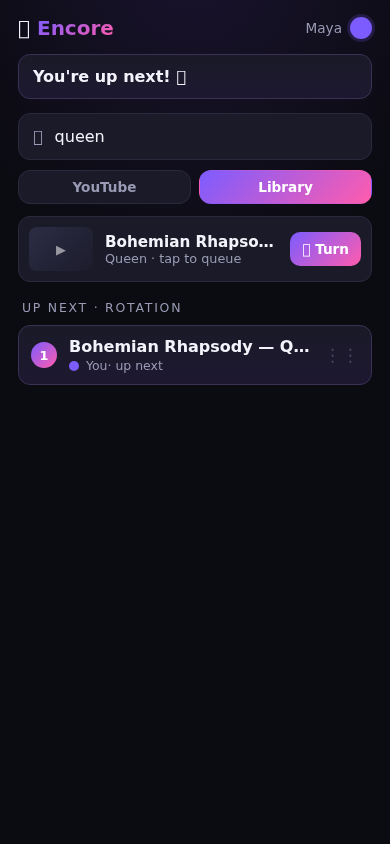
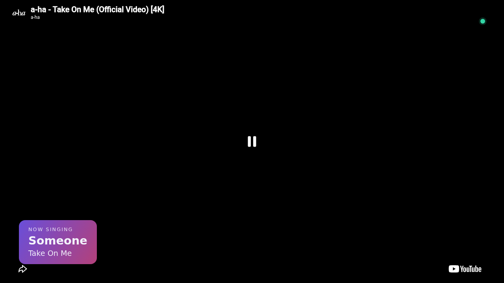

# 🎤 Encore

Self-hosted karaoke that's **mobile-first, wicked fast, and cleaner than any incumbent**.
Scan a QR, queue from YouTube or your library, and sing — with round-robin fairness, a
gapless TV, and live "make-karaoke" stem separation on the roadmap.

> **v0.2.0 (stems)** — YouTube + local search, real-time round-robin queue, two-surface
> phone+TV with gapless playback, **and live "make-karaoke" vocal removal** via Demucs.
> Full design in [`docs/ARCHITECTURE.md`](docs/ARCHITECTURE.md).

## ✨ What it does today

- **📱 Phone remote** — scan to join (name + color, no signup), search YouTube/Library,
  one-tap queue, drag-reorder your picks, remove+undo, now-playing controls, pull-up queue sheet.
- **📺 TV/stage** — four room states (attract → lobby → waiting → playing), gapless two-player
  video, "Now singing" lower-third, "Next up" interstitial, live score badge.
- **🎛️ Make-karaoke** — tap Karaoke on any search result and a Demucs worker strips the vocals;
  the singer keeps their rotation slot while it cooks (~1–2 min/song on CPU).
- **🎤 Word-timed lyrics + live scoring** — WhisperX timings drive a bouncing-ball overlay; mic
  pitch is compared against a reference pitch track for a rolling accuracy score.
- **📚 Karaoke library** — cooked songs persist in a self-describing media volume and are
  browsable by artist and genre.
- **📊 Stats + audit** — `/stats` is a public page (library size, most-sung, top artists, sings per
  day). `/metrics` is the internal one: time per pipeline step with queue wait shown separately,
  end-to-end per cook, and cost per model measured against the whitelist's own declared `rtFactor`.
  Click any song for `/metrics/<mediaId>` — every cook, every retry, which model ran it, and why it
  failed. **The two internal pages are currently ungated** — see Configuration.
- **Round-robin rotation** — everyone's 1st pick before anyone's 2nd; new joiners slot in fairly.
- **Real-time + optimistic** — every tap renders instantly; 20 phones stay synced over flaky
  wifi; reconnects self-heal.

| Phone remote | TV stage |
|---|---|
|  |  |

## 🚀 Quickstart

**Docker (one container — core only):**
```bash
docker compose up                    # build + run core on http://localhost:3000
docker compose --profile stems up    # + the Python Demucs/WhisperX worker (make-karaoke)
```

Deploying on Windows with an NVIDIA GPU? See [`docs/DEPLOY-WSL2.md`](docs/DEPLOY-WSL2.md) — WSL2
networking is the part that bites (phones cannot reach a NAT'd WSL service by default).

**Local dev (Bun ≥ 1.3) — from the repo root:**
```bash
bun install                  # installs workspaces (uses public npm via repo .npmrc)
bun run build && bun run start   # prod build + serve on :3000
# or: bun run dev                # vite dev server (UI HMR only — the WS hub lives in server.ts)
```

`data/` and `media/` are created on first boot; there is no separate migrate step (migrations
apply automatically). For a throwaway instance that leaves nothing behind, set
`ENCORE_EPHEMERAL=1` for an in-memory DB.

Then: open **`/tv`** on the TV/laptop, **scan the QR** with phones → search → queue → sing.
Phones need the host's **LAN IP**, not `localhost` (e.g. `http://192.168.1.20:3000/tv`); the QR
already encodes the right address.

> Prefer `bun run start` (→ `server.ts`) over the adapter's `build/index.js`: `server.ts` owns
> **both** the SvelteKit handler and the WebSocket hub in one process. Serving `build/index.js`
> directly gives you a UI with no realtime.

### The make-karaoke worker

Core alone will happily accept a Karaoke request and then leave it **stuck at `queued` forever** —
stem separation is done by the worker, which is a *separate process*. Either run
`docker compose --profile stems up`, or run it natively:

```bash
cd apps/worker
python3 -m venv .venv
.venv/bin/pip install -r requirements.txt        # torch + demucs + whisperx (multi-GB)

PATH="$PWD/.venv/bin:$PATH" \
  ENCORE_CORE_WS='ws://localhost:3000/ws?role=worker' \
  ENCORE_WORKER_CAPABILITIES='stems,score' \
  MEDIA_DIR=../core/media \
  .venv/bin/python -m src.dial_home
```

The worker **dials home** to core (never the reverse) and shells out to `yt-dlp`, `ffmpeg` and
`demucs` **by name via PATH** — hence the `PATH` prefix above. `MEDIA_DIR` must point at the *same*
directory core is using, or core will mark a job complete for a file it cannot serve.
Expect **~1–2 min/song** on CPU. `ENCORE_WORKER_CONCURRENCY` (default `1`) is how many cook at once.

A native worker also needs a **JavaScript runtime on PATH** — install `deno`. YouTube's player
challenge (the signature and `n` parameters) cannot be solved without one, and yt-dlp additionally
needs its solver script enabled via `--remote-components ejs:github`. Miss either and extraction
silently degrades until **no audio-only format resolves at all**, so every cook fails at download
with `Requested format is not available` — which looks like a broken worker rather than a missing
dependency. The Docker images ship both (`deno` plus `/etc/yt-dlp.conf`); a native run does not, so
either install `deno` and copy `apps/worker/yt-dlp.conf` to `/etc/yt-dlp.conf`, or point yt-dlp at it
with `--config-location`.

For a torch-free smoke test of the plumbing, `ENCORE_PROCESSOR=stub` needs only
`pip install websockets` and walks the whole assign→progress→complete→ready path — but it writes a
**placeholder file, not audio**, so the song will not actually play. Good for wiring, useless for singing.

## Stack

**Bun** runtime · **SvelteKit + Svelte 5 (PWA)** · **`Bun.serve` native WebSocket pub/sub** ·
**`bun:sqlite` (WAL) + Drizzle** · in-memory authoritative state · bundled **yt-dlp + ffmpeg**.
One container for the MVP; a Python **separator + WhisperX** worker joins (container 2) for stems.
See [`docs/ARCHITECTURE.md`](docs/ARCHITECTURE.md).

> **YouTube search** uses keyless `yt-dlp` (bundled in the Docker image). Core invokes it **by name
> via PATH**, so in bare local dev without `yt-dlp` installed, YouTube search silently returns
> empty — no error, just no results — while the **Library** tab keeps working. `brew install yt-dlp`
> (or launch core with the worker venv's `bin` on PATH) fixes it.

## Layout

```
packages/shared/   ← the realtime contract, made physical (imported by client AND server)
apps/core/         ← Container 1: Bun + SvelteKit (the whole MVP)
  server.ts          Bun.serve entry: HTTP + native WS pub/sub hub (one process)
  src/server/        authoritative backend (state, rotation, playback, jobs, media, db)
  src/lib/           client: optimistic store, ws client, components, TV gapless controller
  src/routes/        phone (+page), /join, /tv, /api
apps/worker/       ← Container 2: Python stems/align (dials home; `--profile stems`)
docs/              ← design docs + ROADMAP + UI mocks/screenshots
```

## Configuration

**Core**

| Env | Default | Purpose |
|---|---|---|
| `PORT` | `3000` | HTTP + WS port |
| `HOST` | `0.0.0.0` | bind address (use `127.0.0.1` to keep it off the network) |
| `ENCORE_PUBLIC_ORIGIN` | unset | address the TV's join QR advertises, e.g. `http://10.69.1.169:3000`. Unset = derive from the request. Set it when the machine showing `/tv` cannot reach its own public address (a WSL2 host, or a proxy that forwards no `X-Forwarded-*`). This is the *boot-time* declaration; **Global → Joining** in the settings page overrides it at runtime with no restart |
| `DATA_DIR` | `./data` | SQLite (WAL) location — created if missing |
| `MEDIA_DIR` | `./media` | root of the media volume — created if missing |
| `MEDIA_STORE` | `local` | `local` volume or `object` (MinIO/S3, for remote workers) |
| `INTERSTITIAL_MS` | `2500` | TV "Next up" reveal duration (0 = pure gapless hard-cut) |
| `ENCORE_EPHEMERAL` | unset | `1` → in-memory DB; nothing persists (handy for a throwaway test instance) |
| `FFMPEG_BIN` | `ffmpeg` | ffmpeg binary used for recompression |

**Storage classes** — split by *replaceability* so they can live on different volumes
(see [`docs/ARCHITECTURE.md`](docs/ARCHITECTURE.md)). Each defaults under `MEDIA_DIR`.

| Env | Default | Holds |
|---|---|---|
| `ENCORE_AUDIO_DIR` | `$MEDIA_DIR/audio` | raw originals — **not regenerable; back this up** |
| `ENCORE_DERIVED_DIR` | `$MEDIA_DIR/derived` | stems, pitch, lyrics, thumbs — safe to delete |
| `ENCORE_META_DIR` | `$MEDIA_DIR/meta` | sidecar records — the authoritative library index |
| `ENCORE_MEDIA_MAX_GB` | unset | soft cap; evicts `derived/` LRU-first. Unset = never delete |

**Object store** (only when `MEDIA_STORE=object`) — `S3_BUCKET` (required), `S3_ENDPOINT`,
`S3_REGION`, `S3_PREFIX`. Credentials come from the standard `AWS_*` env vars, which
`Bun.S3Client` reads directly. A missing bucket falls back to `local` rather than failing to boot.

**Worker** (container 2) — `ENCORE_CORE_WS`, `ENCORE_WORKER_CONCURRENCY` (`1`),
`ENCORE_WORKER_CAPABILITIES` (`fetch:ytdlp,stems,align` — the whole cook; add `stems:roformer` for the
RoFormer engine), `ENCORE_WORKER_ID`, `ENCORE_DEMUCS_MODEL`, `ENCORE_WHISPERX_DEVICE`,
`ENCORE_ANNOTATE` (`1`; set `0` to skip the MusicBrainz lookup on a box with no outbound network).

The **lyrics engines** — which Whisper checkpoint reads the words (`tiny`/`base`/`small`/`medium`/`large-v3`)
and how they get timestamps (`forced` word timings vs `lines`) — are a **global setting**, not env: they
live on the Settings page and ride on every `align` job, so changing the model takes effect on the next
cook with no worker restart. `ENCORE_ASR_MODEL` (`base`) and `ENCORE_SYNC_MODE` (`forced`) are only the
fallback for a job that carries neither.

> A worker must advertise `fetch:<downloader>` to acquire source audio — acquisition routes on its own
> capability so a box that downloads and a box that separates need not be the same machine. Advertising
> only `stems` leaves every new song stuck at 0%: the core enqueues a `fetch` nothing can run.

## Status & roadmap

**Done:** M0 foundation · M1 realtime spine · M2 join · M3 phone remote · M4 search ·
M5 gapless TV · M6 hardening → **v0.1.0** · M7 make-karaoke (Demucs stems) → **v0.2.0** ·
M8 word-timed lyrics + live scoring. Then backlog: **B-1** library · **B-5** readiness search ·
**B-6** TV room states + presence · **B-7** media storage classes + browse + retention ·
**B-3** tiered lyrics source chain (LRCLIB → captions → ASR, with provenance labelling) ·
**B-10** stats + audit dashboards (per-attempt job ledger, per-play log, measured model costs).

**Next:** **B-8** swap stem separation to `python-audio-separator` (better models than `htdemucs`;
also improves the ASR lyrics tier, which reads the vocals stem) · **B-9** bake in `yt-dlp` + a
smarter audio-stream pick · **B-4** hot-titles persistence · **M9** accounts + multi-room ·
**B-2** WebAudio pitch-shift (±key is a no-op on the TV today). Open work only:
[`docs/ROADMAP.md`](docs/ROADMAP.md) — shipped history is in [`docs/archive/`](docs/archive/).
Agent/human onboarding: [`docs/HANDOFF.md`](docs/HANDOFF.md).

## Dev notes

```bash
bun test          # 729 unit/integration tests — runnable from the root
bun run check     # svelte-check + types, 0 errors
bun run typecheck # both workspaces
cd apps/worker && pytest   # 328 worker tests — needs `pip install pytest pytest-asyncio`
```

`pytest.ini` sets `asyncio_mode = auto`, so without **`pytest-asyncio`** the async tests fail with
"async def functions are not natively supported" — a missing test dep, not a real failure.

- `apps/core/e2e/party.mjs` — full two-phone + TV flow against a live server. Needs
  `playwright-core` (not a declared dep) plus `PW_CHROMIUM` pointing at a browser, and `EPORT` set.
- Every UI surface is eyes-on verified; screenshots live in `docs/mocks/` as `<id>-<what>-eyeson.png`.
- A green suite is the floor, not the bar — several real defects here were invisible to passing
  tests and only surfaced by driving the app. See [`docs/HANDOFF.md`](docs/HANDOFF.md) §8.
