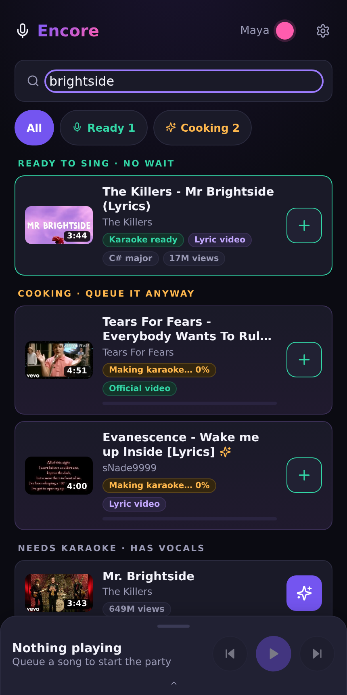
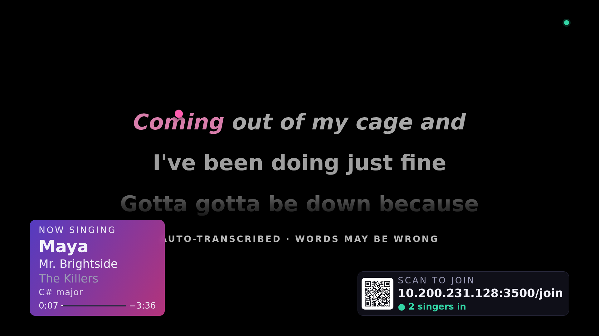

# 🎤 Encore

Self-hosted karaoke for a room full of phones. Scan a QR, queue anything from YouTube or your own
library, and sing — Encore strips the vocals itself, times the words to the music, and keeps the
rotation fair. One container to run it; a second if you want it making karaoke tracks for you.

| Phone remote | TV stage |
|---|---|
|  |  |

Every surface has a frame in [`docs/mocks/`](docs/mocks/) — 30 of them, each one the real app driven
into that state. Design and rationale live in [`docs/ARCHITECTURE.md`](docs/ARCHITECTURE.md).

## Quickstart

**Docker:**

```bash
docker compose up                    # core only, on http://localhost:3000
docker compose --profile stems up    # core + the worker that makes karaoke tracks
```

> **Run the `stems` profile if you want make-karaoke to work.** Core accepts a Karaoke request
> happily and then leaves it at `queued` **forever**, because stem separation happens in the worker —
> a separate process. There is no error on screen; the song just never cooks. This is the single most
> common first-run surprise.

**Local dev (Bun ≥ 1.3), from the repo root:**

```bash
bun install                        # workspaces; uses public npm via the repo .npmrc
bun run build && bun run start     # prod build, served on :3000
# or: bun run dev                  # vite dev server — UI HMR only, no realtime (see below)
```

`data/` and `media/` are created on first boot and migrations apply automatically, so there is no
separate migrate step. `ENCORE_EPHEMERAL=1` gives an in-memory DB that leaves nothing behind.

Then open **`/tv`** on the television, and **scan the QR** with phones.

> **Phones need the host's LAN IP, not `localhost`** — e.g. `http://192.168.1.20:3000/tv`. The QR
> encodes the right address automatically, and if it can't, the TV says so on screen instead of
> showing a QR that goes nowhere. Deploying on Windows with an NVIDIA GPU? Read
> [`docs/deploy/WSL2.md`](docs/deploy/WSL2.md) first — WSL2's NAT is exactly the case that breaks this.

> Prefer `bun run start` (→ `server.ts`) over the adapter's `build/index.js`. `server.ts` owns **both**
> the SvelteKit handler and the WebSocket hub in one process; serving `build/index.js` directly gives
> you a UI with no realtime at all.

### The make-karaoke worker

To run it natively instead of in Docker:

```bash
cd apps/worker
python3 -m venv .venv
.venv/bin/pip install -r requirements.txt        # torch + demucs + whisperx (multi-GB)

PATH="$PWD/.venv/bin:$PATH" \
  ENCORE_CORE_WS='ws://localhost:3000/ws?role=worker' \
  MEDIA_DIR=../core/media \
  .venv/bin/python -m src.dial_home
```

Those two variables are the whole configuration — the worker measures the rest and prints what it
found, including one line per capability with the evidence for it. A capability whose tool is
**missing** is reported as loudly as one that is present, because that line is what explains a song
stuck at 0%. `ENCORE_WORKER_CAPABILITIES` can only *narrow* what it advertises, never widen it. The
full model is in [`docs/ARCHITECTURE.md`](docs/ARCHITECTURE.md) §7.

The worker **dials home** to core, never the reverse, and shells out to `yt-dlp`, `ffmpeg` and
`demucs` **by name via PATH** — hence the `PATH` prefix above, and why capabilities are probed against
PATH too. `MEDIA_DIR` must point at the *same* directory core is using, or core will mark a job
complete for a file it cannot serve. Expect **~1–2 min/song** on CPU;
`ENCORE_WORKER_CONCURRENCY` (default `1`) sets how many cook at once.

A native worker also needs a **JavaScript runtime on PATH — install `deno`.** YouTube's player
challenge (the signature and `n` parameters) cannot be solved without one, and yt-dlp needs its solver
enabled via `--remote-components ejs:github`. Miss either and extraction degrades silently until no
audio-only format resolves at all, so every cook fails at download with `Requested format is not
available` — which reads as a broken worker rather than a missing dependency. The Docker images ship
`deno` plus `/etc/yt-dlp.conf`; a native run does not, so install `deno` and either copy
`apps/worker/yt-dlp.conf` to `/etc/yt-dlp.conf` or point yt-dlp at it with `--config-location`.

Separately: **not every YouTube video will download.** Upstream bot-checking rejects some, and a
handful of failed cooks on specific videos is not a broken install — see
[`docs/HANDOFF.md`](docs/HANDOFF.md).

`ENCORE_PROCESSOR=stub` swaps in a no-ML processor for smoke-testing the plumbing, and needs only
`pip install websockets`. Two caveats worth knowing before you reach for it: it writes a
**placeholder file, not audio**, so nothing will actually play; and because capabilities are still
probed for real, a box without demucs and whisperx advertises only `fetch:ytdlp` — so the stub can
exercise the download step but **cannot** walk the stems or align steps on the very torch-free box you
would want it for.

## What it does

- **Phone remote** — scan to join (name and a colour off a hue wheel, no signup), one search box over
  YouTube and your library ordered by whether you can sing it *now*, one-tap queue, drag-reorder,
  remove with undo, now-playing transport, and a pull-up rotation sheet.
- **TV stage** — four room states (attract → lobby → waiting → playing), gapless two-player video, a
  "now singing" lower third, and a song-intro card between turns.
- **Make-karaoke** — tap Karaoke on any result and the worker strips the vocals. The singer keeps
  their rotation slot while it cooks.
- **Word-timed lyrics** — WhisperX timings drive a bouncing-ball overlay; marker, highlight, size,
  font, case and row counts are all room settings. When a song has several releases, Encore grades
  each candidate set of words against what is *actually audible* and the closest one wins, so
  "Telephone (feat. Beyoncé)" stops singing the lyrics of "Telephone". Words it had to transcribe
  itself are labelled as such on screen. How the grading works:
  [`docs/ARCHITECTURE.md`](docs/ARCHITECTURE.md) §8.
- **Guiding track** — fade the original singer back in, quietly, for a song you don't quite know.
  Per song, with a room default.
- **Key shift** — ± semitone in the browser, with the sounding key and the range the song demands
  updating as you move it.
- **Karaoke library** — cooked songs persist in a self-describing media volume, browsable by artist
  and genre.
- **House rules** — fair rotation (the default: everyone's 1st pick before anyone's 2nd), first come
  first served, shuffle, or whoever sang longest ago. A room setting, so changing it re-orders what's
  waiting instantly and never interrupts what's playing.
- **Stage look** — black (the default), room glow, the singer's colour, a fixed colour, or an audio
  visualizer (plasma, starfield, ripples, phase curves). Every option is pinned dark so the lyrics
  stay readable. There are deliberately no spectrum bars: the TV does not listen to the audio, so they
  would only be pretending. Why: [`docs/ARCHITECTURE.md`](docs/ARCHITECTURE.md) §4.
- **Stats and audit** — `/stats` is public and aggregate-only (library size, most-sung, top artists,
  sings per day). `/metrics` is internal: time per pipeline step with queue wait separated out,
  end-to-end per cook, and cost per model measured against the model's own declared `rtFactor`. Any
  song links to `/metrics/<mediaId>` — every run, every retry, which model ran it, and why it failed.
- **Real-time and optimistic** — every tap renders instantly, twenty phones stay in sync over flaky
  wifi, and reconnects self-heal.

## Security

> ⚠️ **Encore has no operator identity. Treat it as trusted-LAN-only software.**
>
> - Any device that can reach the port can join as a singer, and **any joined phone can `PUT
>   /api/settings`** — which includes the separator engine and which Whisper weights the fleet loads.
> - **Set `ENCORE_WORKER_TOKEN`.** Without it, `role=worker` WebSocket upgrades are unauthenticated:
>   anything that can reach the port can register as a worker and start receiving job assignments.
>   Core logs one loud warning at startup when it is unset.
> - `/metrics` and `/api/audit/*` are **ungated** — they expose worker ids, host details, model names,
>   file paths and error strings (no singer identities and no media bytes).
>
> Bind to a trusted interface (`HOST=127.0.0.1` keeps it off the network entirely) or put it behind a
> gateway. Do not expose the port to a network you don't trust. Tracked as open work in GitHub issues.

## Stack

**Bun** runtime · **SvelteKit + Svelte 5 (PWA)** · **`Bun.serve` native WebSocket pub/sub** ·
**`bun:sqlite` (WAL) + Drizzle** · in-memory authoritative state · bundled **yt-dlp + ffmpeg**. One
container for core; a Python **separator + WhisperX** worker joins as container 2 for stems.

> **YouTube search** uses keyless `yt-dlp`, bundled in the Docker image. Core invokes it **by name via
> PATH**, so in bare local dev without `yt-dlp` installed YouTube search silently returns empty — no
> error, just no results — while the library keeps working. `brew install yt-dlp`, or launch core with
> the worker venv's `bin` on PATH.

## Layout

```
packages/shared/   ← the realtime contract, made physical (imported by client AND server)
apps/core/         ← Container 1: Bun + SvelteKit
  server.ts          Bun.serve entry: HTTP + native WS pub/sub hub (one process)
  src/server/        authoritative backend (state, rotation, playback, jobs, media, db)
  src/lib/           client: optimistic store, ws client, components, TV gapless controller
  src/routes/        phone (+page), /join, /tv, /settings, /stats, /metrics, /api
  e2e/               selector contract + guard, the party flow, the screenshot capture
apps/worker/       ← Container 2: Python stems/align (dials home; `--profile stems`)
docs/              ← ARCHITECTURE + HANDOFF + DECISIONS; deploy/ benchmarks/ mocks/ research/
```

## Configuration

**Core**

| Env | Default | Purpose |
|---|---|---|
| `PORT` | `3000` | HTTP + WS port |
| `HOST` | `0.0.0.0` | bind address (use `127.0.0.1` to keep it off the network) |
| `ENCORE_WORKER_TOKEN` | unset | shared secret required on `role=worker` WS upgrades; a worker without a matching `token` gets `401`. **Unset means worker registration is unauthenticated** — see Security |
| `ENCORE_PUBLIC_ORIGIN` | unset | address the TV's join QR advertises, e.g. `http://10.69.1.169:3000`. Unset = derive from the request. Set it when the machine showing `/tv` cannot reach its own public address (a WSL2 host, or a proxy that forwards no `X-Forwarded-*`). This is the *boot-time* declaration; **Global → Joining** in settings overrides it at runtime with no restart |
| `DATA_DIR` | `./data` | SQLite (WAL) location — created if missing |
| `MEDIA_DIR` | `./media` | root of the media volume — created if missing |
| `MEDIA_STORE` | `local` | `local` volume or `object` (MinIO/S3, for remote workers) |
| `ENCORE_SONG_INTRO_MS` | seeds `2500` | song-intro card duration, seeded into the room on **first boot only** (`0` seeds it off, for a pure gapless hard-cut). `INTERSTITIAL_MS` is still read as a deprecated alias. Both the duration and the on/off toggle live in **Settings → Room** afterwards |
| `ENCORE_LYRICS_BACKFILL` | on | set `0` to skip the boot-time lyrics backfill for already-cooked songs |
| `ENCORE_VOCALS_BACKFILL` | on | set `0` to skip the boot-time guiding-track (vocals stem) backfill |
| `ENCORE_EPHEMERAL` | unset | `1` → in-memory DB; nothing persists (handy for a throwaway instance) |
| `FFMPEG_BIN` | `ffmpeg` | ffmpeg binary used for recompression |

**Storage classes** — split by *replaceability* so they can live on different volumes (see
[`docs/ARCHITECTURE.md`](docs/ARCHITECTURE.md) §6). Each defaults under `MEDIA_DIR`.

| Env | Default | Holds |
|---|---|---|
| `ENCORE_AUDIO_DIR` | `$MEDIA_DIR/audio` | raw originals — **not regenerable; back this up** |
| `ENCORE_DERIVED_DIR` | `$MEDIA_DIR/derived` | stems, lyrics, thumbs — safe to delete |
| `ENCORE_META_DIR` | `$MEDIA_DIR/meta` | sidecar records — the authoritative library index |
| `ENCORE_MEDIA_MAX_GB` | unset | soft cap; evicts `derived/` LRU-first. Unset = never delete |

**Object store** (only when `MEDIA_STORE=object`) — `S3_BUCKET` (required), `S3_ENDPOINT`,
`S3_REGION`, `S3_PREFIX`. Credentials come from the standard `AWS_*` env vars, which `Bun.S3Client`
reads directly. A missing bucket falls back to `local` rather than failing to boot.

**Worker** — two settings, and everything else is measured.

| Env | Purpose |
|---|---|
| `ENCORE_CORE_WS` | where core is. No probe can guess this |
| `MEDIA_DIR` | the volume core is also using. Must match, or core serves a file that isn't there |

Everything else is an **override**, unset by default and present only for when a measurement is wrong
or you want to deliberately limit a box:

- **Placement** — `ENCORE_WORKER_CAPABILITIES` (narrows only), `ENCORE_WORKER_ID` (hostname when
  unset), `ENCORE_WORKER_TOKEN` (must match core's), `ENCORE_WORKER_CONCURRENCY` (`1`)
- **Device** — `ENCORE_DEVICE` (`cpu`/`cuda`/`xpu`/`mps`, and `cuda:1` style indices),
  `ENCORE_SEPARATOR_BACKEND` (`torch`/`mlx`), `ENCORE_WHISPERX_DEVICE` (alignment only; CTranslate2
  does `cpu`/`cuda` and nothing else), `ENCORE_TORCH_THREADS`. `ENCORE_DEMUCS_DEVICE` is a deprecated
  alias of `ENCORE_DEVICE` and now sets the device for the whole worker
- **Separation** — `ENCORE_DEMUCS_MODEL`, `ENCORE_DEMUCS_JOBS` (auto-derived from usable cores),
  `ENCORE_DEMUCS_OVERLAP`/`_SEGMENT` (auto-derived from *free* accelerator memory)/`_SHIFTS`, `ENCORE_STEM_BITRATE` (`192k`), `ENCORE_FLAC_LEVEL`
  (`8`)
- **Lyrics and metadata** — `ENCORE_ASR_MODEL` (`base`) and `ENCORE_SYNC_MODE` (`forced`) are only
  fallbacks for a job carrying neither, `ENCORE_LRCLIB_BASE` (point at a mirror when lrclib.net is
  blocked), `ENCORE_ANNOTATE` (`1`; set `0` on a box with no outbound network)
- **Escape hatches** — `ENCORE_PROCESSOR` (`real`/`stub`), `ENCORE_YTDLP_BIN`, `ENCORE_DEMUCS_BIN`,
  `ENCORE_FFMPEG_BIN`

What the worker measures for itself: the **accelerator** (CUDA / ROCm / Intel xpu / Apple MPS / CPU,
via `torch.accelerator` then a per-device usability probe), **usable cores** (the tightest of
`cpu_count`, scheduler affinity and the cgroup quota — a container throttled to 2 cores no longer
sizes itself for the host's 32), **memory**, **free accelerator memory** (which is what a demucs
segment has to fit inside — a 12 GB card with a display server and another cook on it can have under
3 GB left, and a worker that sizes itself for 12 dies at the first chunk with an OOM the room sees as
a failed song), the **alignment device**, and its **capabilities**.

Two things that look like env vars but are **settings**, so they change with no restart: the **lyrics
engines** (which Whisper checkpoint reads the words, and whether timings are per-word or per-line) are
global and ride on every `align` job; the **stage look**, **house rule**, **TV progress placement** and
every **lyrics presentation** option are per-room.

## Status & roadmap

**Done:** the realtime spine (join, phone remote, search, gapless TV, room states + presence),
hardening → **v0.1.0**, make-karaoke (Demucs stems) → **v0.2.0**, word-timed lyrics, the saved
library, readiness search, media storage classes + browse + retention, the tiered lyrics source
chain (LRCLIB → captions → ASR with provenance labelling) and its two-tier version selection
(candidates graded against audible baselines), stats + audit dashboards, browser pitch-shift so ±key
actually transposes, and the song profile (detected key + the vocal range a song demands, on all
three surfaces). yt-dlp + deno are baked into the worker image, with a smarter audio-stream pick
that prefers Opus over legacy AAC.

**Next:** swap stem separation to `python-audio-separator` (better models than `htdemucs`; also
improves the ASR lyrics tier, which reads the vocals stem), hot-titles persistence, and accounts +
multi-room. Open work
in GitHub issues. Ratified decisions and the parked scope fence are in
[`docs/DECISIONS.md`](docs/DECISIONS.md). Agent and
human onboarding: [`docs/HANDOFF.md`](docs/HANDOFF.md).

## Dev notes

```bash
bun test          # 1168 unit/integration tests — runnable from the root
bun run check     # svelte-check + types, 0 errors
bun run typecheck # both workspaces
cd apps/worker && pytest   # 450 worker tests — needs `pip install pytest pytest-asyncio`
```

`pytest.ini` sets `asyncio_mode = auto`, so without **`pytest-asyncio`** the async tests fail with
"async def functions are not natively supported" — a missing test dep, not a real failure.

- `apps/core/e2e/contract.ts` is the **selector contract**: one declaration of every hook the browser
  flows drive, guarded by `contract.test.ts` so `bun test` fails the moment a selector's anchor
  disappears from the source. It exists because the previous e2e rotted silently — three selector
  families moved and the suite stayed green.
- `apps/core/e2e/party.mjs` — the full two-phone + TV flow against a live server.
- `apps/core/e2e/capture.mjs` — regenerates every frame in `docs/mocks/`. See
  [`docs/mocks/README.md`](docs/mocks/README.md) for how to run it and the two things that make the
  playing-state frames possible.
- Every UI surface is eyes-on verified; frames live in `docs/mocks/` as `tour-<what>-eyeson.png` —
  one regenerable set with stable filenames, so refreshing a frame updates every reference to it.
- A green suite is the floor, not the bar — several real defects here were invisible to passing tests
  and only surfaced by driving the app. See [`docs/HANDOFF.md`](docs/HANDOFF.md) §8.
