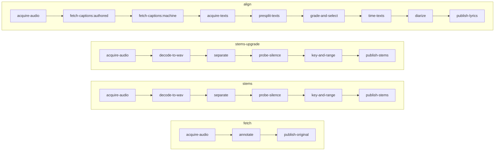

# Encore — Architecture

> **Status:** living · canonical description of the system as built.
>
> This is the one architecture document. Detailed original specs are preserved under
> [`archive/reference/`](archive/reference/) for design archaeology, not as current instructions.
> Open work is tracked in GitHub issues; ratified decisions and the scope fence are in
> [`DECISIONS.md`](DECISIONS.md); operational traps belong in [`HANDOFF.md`](HANDOFF.md).

## 1. Product and core loop

Encore is a self-hosted karaoke server with two surfaces:

- **Phone remote:** QR join (name + color, no signup), then three surfaces under one persistent
  now-playing band: the queue at `/`, unified YouTube/library search grouped by readiness at `/find`,
  and one song's detail at `/song/[mediaId]`. One-tap queue, singer-owned reordering, and the live
  controls — transport, ±key, guiding track, lyrics re-pick — in the drawer the band pulls up into.
- **TV/stage:** attract → lobby → waiting → playing, gapless two-player playback, lower-third,
  lyrics, persistent join card.

The loop is deliberately simple:

> phone queues → server decides rotation → TV renders → server broadcasts truth → phones converge.

Round-robin is by **singer**, not FIFO: everyone's first pick before anyone's second. A song processing
at the front is skipped without losing its fairness position (the **held-slot rule**).

## 2. Deployment and stack

```
┌─ Container 1: encore-core ───────────────────────────────────────┐
│ Bun · SvelteKit/Svelte 5 · Bun.serve HTTP + native WebSockets    │
│ Drizzle + bun:sqlite (WAL) · in-memory authoritative room state  │
│ yt-dlp + ffmpeg · phone UI + TV UI + REST + realtime hub         │
└───────────────────────────────────────────────────────────────────┘
┌─ Container 2: encore-worker ─────────────────────────────────────┐
│ Python · separator · WhisperX · ffmpeg                            │
│ dials home over WebSocket · stems + lyrics alignment             │
└───────────────────────────────────────────────────────────────────┘
```

| Layer   | Choice                               | Constraint it satisfies                                        |
| ------- | ------------------------------------ | -------------------------------------------------------------- |
| Runtime | **Bun 1.3.14**                       | native WS pub/sub, `bun:sqlite`, `Bun.spawn`, one core process |
| UI      | **SvelteKit + Svelte 5 runes**, PWA  | small bundle, fine-grained updates, phone-first                |
| Adapter | `svelte-adapter-bun`                 | SvelteKit handler and WS hub served by `server.ts`             |
| DB      | **Drizzle + bun:sqlite**, WAL        | durable index and party state without another service          |
| Worker  | **Python**                           | isolates the multi-GB ML stack from core                       |
| Media   | yt-dlp + ffmpeg                      | source resolution, decode, encode, probing                     |
| Storage | local roots or S3/MinIO `MediaStore` | single-box default, remote-worker seam                         |

**Locked:** do not re-litigate Bun/Node/Deno. Performance comes primarily from the architecture, but
Bun's primitives map directly to it.

Repository shape:

```
packages/shared/   realtime contract + pure shared reducers
         SvelteKit surfaces + Bun server + SQLite + media/job coordination
worker/       dial-home Python worker + separator/WhisperX processors
docs/              ARCHITECTURE + HANDOFF + DECISIONS at root; everything else in a subfolder
                   (deploy/ benchmarks/ mocks/ research/)
```

## 3. Authority and realtime

Core is the single authority for queue and playback. Phones predict and command; TV renders and
reports telemetry; workers report progress and artifacts.

```
phone  ── commands ──► core ── queue/playback/media broadcasts ──► all clients
TV     ── telemetry ─► core
worker ── dial-home job protocol ─► core
```

Important events:

| Event                | Direction     | Purpose                                                    |
| -------------------- | ------------- | ---------------------------------------------------------- |
| `queue:patch`        | core → all    | authoritative diff plus revision and inline media snapshot |
| `queue:sync`         | core → one    | full state on connect/resync, including presence snapshot  |
| `playback:state`     | core → all    | current entry, position, playing state                     |
| `nowplaying:changed` | core → all    | current + up-next; drives TV preload                       |
| `media:status`       | core → all    | processing stage/progress/readiness                        |
| `singer:presence`    | core → all    | ref-counted online transition                              |
| `player:command`     | phone → core  | play/pause/skip/seek/restart                               |
| `tv:telemetry`       | TV → core     | actual playback position/end/buffering                     |
| `job:*`              | worker ↔ core | assign/accept/progress/complete/fail                       |

### Optimistic reconciliation invariant

> **`client.predict(op) === server.apply(op)` for every mutation path**, including round-robin resequencing.

The mechanism is intentionally small:

1. Client mints a ULID for both the operation and any new queue entry.
2. Client applies the shared `QueueOp` immediately and stores its inverse in a pending-op map.
3. Server validates, applies the **same shared reducer**, increments monotonic `rev`, persists, then
   broadcasts the canonical patch with `causedBy: clientOpId`.
4. Origin clears pending and adopts canonical fields; other phones apply the same patch.
5. Reject applies the stored inverse and shows the reason.
6. Revision gap or reconnect requests `queue:sync`; pending operations rebase and resend
   idempotently.

`src/lib/contract/queue/rotation.ts` is imported by both sides. Never fork its logic. Validate every
client field before it reaches state/SQLite — one missing `singerId` once killed the whole server.

### Where the client's copy of that truth lives

The phone's half of the loop above is owned by ONE object rather than by a route.
`src/lib/stores/room.ts` holds `RoomLink` and the `room` singleton: the `/api/me` probe, the
`QueueStore`, the `WsClient`, and every field the room broadcasts into — playback, singers, the media
catalog, effective settings, the away set, live process statuses, and the saved library. Surfaces
**subscribe and mirror** the fields they render.

All of it used to be CONSTRUCTED in `src/routes/+page.svelte`'s `onMount`, which made a route the owner
of app-wide truth, and that had one consequence which finally forced the move: a component mounted in
`src/routes/+layout.svelte` could not read the playback state, because the only thing that knew it was a
sibling route component. Persistent chrome was therefore impossible rather than merely awkward, and the
socket is simply not a property of a route — one phone joins one room once.

Three properties of the owner are deliberate:

- **It is a plain class with an explicit `subscribe`, not a rune-backed `.svelte.ts` store.** A
  module-level `$state` singleton is shared across SSR requests on the server, which is a cross-request
  leak waiting to happen; plain fields that only ever move in the browser cannot leak that way.
  `src/lib/stores/queue.ts` beside it already established subscribe-and-mirror and is tested that way,
  so a second idiom in one directory is a thing every reader learns twice. And mirroring per component
  means the band does not re-render on a library merge it does not read.
- **The socket lives for the DOCUMENT, not the route.** `connect()` is idempotent and browser-only, and
  nothing closes the connection on navigation — the band and the drawer have to survive it. `close()`
  exists for a test; the document closing takes the socket with it. A guest who has not joined settles
  with no socket at all.
- **The root layout gates connecting on a not-a-phone list.** `src/routes/+layout.svelte` is the ROOT
  layout, so it wraps the television: an ungated `room.connect()` would open a second `role=phone`
  socket on `/tv` — which already holds its own `role=tv` one — and register the television as a singer
  present in the room. The list is deliberately the same four exemptions the phone-route walk already
  enforces, rather than a second opinion about what a phone surface is.

Two seams follow from single ownership, and both are the reason for it rather than a side effect. The
**saved library** is owned here because its one fetch serves two readers: it gives `/find` its rows AND
seeds the media catalog and live statuses the QUEUE reads for its titles and progress bars on a cold
load. Sharing one function body inside a route meant the queue's titles depended on the search surface
having run — invisible while they were one file, a silent breakage the moment they were not. And the
held **failed-process scars** must be maintained rather than snapshotted at connect: the link does not
remount, so a failure arriving after connect has to join the held list, or the next `queue:sync`
replaces the catalog and wipes the very row the scar exists to survive a reload.

### The phone's surfaces

Chrome first, because it is what the ownership above bought.
`src/lib/components/NowPlayingBand.svelte` is mounted by the layout as the bottom-most chrome of every
phone surface: the title, who is singing, a search button, and a transport disc whose progress **ring**
replaced both an elapsed number and a separate thumbnail — the transport button can BE the artwork.
`progress` is a fraction **or null**, and null draws an EMPTY ring rather than one pinned at zero,
because a 0% ring reads as a stalled song (the same null-not-zero rule the queue peek applies). The
band is presentational — no socket, no store, no `$app/*` import — and `position: fixed` lives on the
layout's `.dock` wrapper instead of on the component, because `/components` renders five bands to show
every state and a fixed one would collapse all five onto the same strip. Its **measured** height is
published as `--dock-h` on documentElement so every scrolling column reserves it in normal flow, and
`env(safe-area-inset-bottom)` lives on the band alone and reaches everything stacked above it through
that token — a second `env()` term higher up doubles the gap.

Pulling the band up opens `src/lib/components/NowPlayingDrawer.svelte`, which holds the live controls:
the seek row, the transport, ±key with the vocal range directly beneath it, the guiding-track level, and
lyrics re-selection. `handleOnly` is the load-bearing prop: vaul drags to dismiss from anywhere in its
content, and this drawer's body is sliders, so a drag surface underneath them would make the two
gestures one gesture and the ancestor would win. Dragging is restricted to the handle — a whitelist,
chosen over a blacklist of opt-out elements because a whitelist cannot be forgotten when a control is
added later. The container also satisfies a mount constraint that used to be a condition someone had to
remember: `src/lib/components/GuidingTrack.svelte` wraps a slider that reads `offsetWidth` and must not
mount hidden, and a drawer portals its content on open and destroys it on close, where a collapsible
renders its content always and merely hides it.

The routes then divide by the question each answers:

| Surface           | Answers                              | Notes                                                                                        |
| ----------------- | ------------------------------------ | -------------------------------------------------------------------------------------------- |
| `/`               | who is up, and where am I            | the queue and nothing else; a guest who has not joined gets the landing state instead        |
| `/find`           | what can I sing                      | search, whose **zero-query state is the saved library**                                      |
| `/song/[mediaId]` | can I sing THIS, are the words right | reached from the drawer's "···"; shares `GET /api/audit/[mediaId]` with `/metrics/[mediaId]` |

Two of those are reversals worth recording rather than quietly dropping.

**The hero is gone.** Home used to open with a card for a song someone else is singing, which spent the
top third of the screen on the one thing a guest cannot act on, pushed the rotation down the page, and —
once the band existed — said "Nothing playing" twice on one screen. Its content moved into the drawer,
which is a change of PLACE and not of content: the same song identity, seek row, transport and live
controls, none of it occupying the queue any more.

**Search is a place you go, not a mode.** It used to be a box docked in the thumb zone whose results
expanded UPWARD in place over the queue, explicitly with no browse mode and no `?browse=1`, because
there was nothing to navigate back out of. That reasoning was about a box that lived on home; the band
took the bottom edge, so keeping the box there would have put two surfaces on one edge. Once search is
somewhere you GO — a tap on the band's magnifier — a route is what makes the phone's own back gesture
the way back. Note what did not come back with it: there is still no browse TOGGLE, because the surface
IS the browse view, and results read DOWNWARD from a header, so the best match is first and the
scroll-to-the-end orchestration is gone rather than re-pointed. `/find` focuses its box on arrival,
since getting there is already a deliberate tap.

`/song/[mediaId]` is a route rather than a second sheet stacked on the drawer, on a forward-looking
argument: lyrics timing and editing are becoming a comprehensive system, and a sheet that grows into a
workspace is the wrong container to start one in — a chooser is not an editor. It **fetches** instead of
reading the link, because the client catalog only holds songs the room has touched and this page is
reachable for any id, including a song processed on an earlier night. It reads the link for exactly the
live fact the audit row cannot know: the room's current `keyShift`, so its range readout describes what
the TV is sounding rather than the song at concert pitch. The drawer closes itself as it navigates,
since it lives in the layout and would otherwise cover the page it just opened.

## 4. Rotation, presence, and room state

### Rotation

`rotate` / `assignSeqs` / `applyAndReseq` own fairness. Terminal entries (`done`/`canceled`) are
pruned on apply and hydrate. A not-ready file entry is skipped by `isEntryReady` but keeps its
`rotationSeq`, so processing never burns a singer's turn.

WHICH ordering is a room setting (`RoomSettings.queueOrder`), and the registry is
`src/lib/contract/queue/queue-order.ts` (built with `makeRegistry`, like every other flat registry): fair
rotation (the default and the pre-setting behaviour),
first-come-first-served, a stable shuffle, and whoever-sang-longest-ago. Adding one is a registry
entry plus one pure function — as long as it needs nothing but the queued entries and `Ordering`.

Three things make this work, and all three are load-bearing:

- **The ordering is threaded, not looked up.** Every function takes an optional `Ordering`
  (`{ order, lastSungAt }`) defaulting to fair, so a caller with no settings to hand behaves as it did
  before the setting existed. The server assembles it in ONE place — `orderingOf(deps)` in
  `realtime/hub.ts` — because a second source is how the server comes to pick a different "next" than
  the queue every client is looking at.
- **The client must know it.** `applyAndReseq` runs on the phone too; predicting with fair rotation in
  a first-come-first-served room puts every add in the wrong place for a frame and then snaps. The
  phone holds `EffectiveSettings` (seeded from `queue:sync`, kept live by `settings:changed`) and hands
  the store a _getter_, so a mid-party change needs no re-wiring.
- **Changing it must reseq the live queue.** Unlike every other room setting, this one is not a
  render-time choice: `rotationSeq` is stored per entry, so `PUT /api/settings/room` calls
  `state.reorder()` and broadcasts a `queue:patch`. `reorder()` returns null when the order is
  unchanged and then touches nothing, which is what makes it safe to call from the playback path too.
  It never interrupts the current song — ordering ranks only `queued` entries.

`least-recently-sung` reads `Singer.lastSungAt`, stamped at song START (their remaining picks should
drop behind everyone else's the moment their turn begins). It lives on the singer, not in `plays`,
because that table deliberately carries no singer id: this records THAT someone sang and when, never
what. With no history the policy is exactly fair, so a party starts identically either way.

A drag-reorder stays policy-agnostic: `reorderWithinSinger` rewrites the stored list, permuting the
singer's own songs among the queued slots that singer already holds, so no other singer's row shifts and
nobody can jump anybody. (`moveToIndex` is the cross-singer sibling, counting every queued entry.) The
phone therefore offers reordering **unconditionally**. It did not always: while rank under `shuffle` was
re-derived from the entry id a move was a legal no-op there, and the arrows were hidden for it. Nothing
re-derives a position now — the stored list is the source of truth — so there is no ordering that can
discard a move.

### Presence

The WS upgrade identifies a singer from the session cookie. `PresenceTracker` is ref-counted and
broadcasts only on 0→1 / 1→0. `queue:sync` carries the current online snapshot. Never infer presence
from the `singers` table — it is persistent and append-only.

### TV screen precedence

The pure `tvScreen()` decision is:

```
playing > waiting > lobby > attract
```

- **attract:** nobody present; full-screen QR.
- **lobby:** people present, no queue; hero QR + roster.
- **waiting:** queued media still processing.
- **playing:** media, lower-third, lyrics, compact join card.

Spatial ownership is contractual: lower-third = bottom-left, join card = bottom-right.

### Stage stacking

Also contractual, and easy to break by accident because the layers live in three different files:

```
0  stage background   (.stage-bg — tv/+page.svelte)
1  hidden player slot (TvPlayer)      ─┐ the gapless pair; the visible one
2  visible player slot (TvPlayer)     ─┘ carries z-index 2
5  attract / lobby glow               (these OWN the idle screens and paint opaque)
6  lyrics overlay · lower-third
7  interstitial · TV progress
8  connection status dot
```

Two consequences worth stating, because both were live defects:

- **Nothing above 0 may paint an opaque background.** `TvPlayer`'s `<video>` used to carry its own
  `background: an earlier change`, which — since a process song has no video track and `object-fit: contain`
  letterboxes — painted the whole screen black and hid layer 0 completely. It is `transparent` now;
  `.tv`'s own black is the floor.
- **The background is shown for the whole playing BAND, not just `screen === 'playing'`.** It is gated
  on the same `!isAttract` flag as the player slots, so it also covers `waiting` (a song is on stage,
  still processing) and the interstitial. Gating it on `playing` alone puts a black flash between every
  song.

### The stage layer can host a renderer, not just a colour

`stageBackgroundCss` resolves a style to a CSS `background` string, which is enough for every colour
option. The `visualizer` style is the exception: a drawing loop is not expressible as a CSS value, so
that case returns `an earlier change` — the **floor** — and a `<canvas>` mounts **inside the same `.stage-bg`
layer**, not beside it. One layer, one visibility gate, one crossfade; a sibling element would have to
be kept in agreement with this one about when to show.

The renderers themselves are **pure functions of time** in `lib/tv/visualizers.ts`; the component owns
only the loop. A canvas inside a `.svelte` file cannot be unit-tested here, and the colour bound below
is enforced by driving those functions against a fake context — so the split is what makes the bound
real rather than aspirational.

Nothing on the TV reads the audio: there is no `AudioContext` on that surface, and no user gesture
anywhere on `/tv` to start one. The visualizers are therefore time-driven, and the registry
**deliberately excludes spectrum bars and an oscilloscope** — those assert they are drawing the signal,
and drawing them from a timer is the defect the lyrics overlay refuses by name ("a lie dressed as
precision"). Adding real analysis means adding a `MediaElementAudioSourceNode` per `<video>`, which
must reach `ctx.destination` or the song goes silent.

**Motion budget.** This is the second `requestAnimationFrame` loop on the TV — `LyricsOverlay` already
interpolates position telemetry to 60fps, and the lyric ball has the stronger claim. So the visualizer
caps at ~30fps, renders to a half-scale backing store, and cancels its frame when the stage is not
shown. `prefers-reduced-motion: reduce` draws one still frame and stops.

### Colour tiers

Two OKLCH tiers, both generated by `hueToHex` in `src/lib/contract/presentation/colors.ts`, and the split is a
legibility bound rather than taste:

| tier   | L / C       | used for                                                                                                     |
| ------ | ----------- | ------------------------------------------------------------------------------------------------------------ |
| singer | 0.70 / 0.16 | the singer dot — small fill on a dark card, needs 3:1 non-text                                               |
| stage  | 0.22 / 0.07 | the `singer` glow and the visualizer palettes — **derived** TV colours, sitting **behind word-timed lyrics** |

`stageHueToHex` additionally ramps lightness down toward 0.13 as a hue closes on `--accent2`'s hue
(345°, the "sing this now" active word) over a 60° band. Without it a pink singer's stage and the
active-word highlight are the same hue family and the cue stops reading. The ramp is continuous
rather than a threshold, so adjacent wheel stops cannot get wildly different stages.

Raising either tier's lightness regresses the lyrics. Tests assert the bound (white clears 4.5:1, the
active pink clears 3:1, on all 24 wheel stops) rather than any literal hex.

**The stage tier no longer bounds the room's own colour**. The room used to store a hue angle
and every stage went through `stageHueToHex`, which made the tier an inescapable legibility bound. The
owner retired that bound and moved the job it was doing onto the thing it protected: the lyric reel
paints its own `-webkit-text-stroke` outline, which holds on any field _and_ over a music video,
which a bound on the stage colour could never reach. So `RoomSettings.tvBackgroundColor` is a real hex
rendered verbatim — a room may pick white — while the tier still governs every colour nobody chose by
hand, because an unasked-for bright field has no explanation. `hueOfColor` recovers an angle from the
stored hex for the visualizers, which build their palettes by hue arithmetic.

## 5. Gapless playback

TV owns two media surfaces: A is visible/current, B is hidden/warming `upNext`. Core sends up-next as
soon as rotation knows it, so B normally has minutes to buffer. On `ended`, TV reports telemetry and
swaps to B; it does not decide the next queue entry itself.

```
ATTRACT → LOADING → PLAYING ── ended ──► INTERSTITIAL → SWAP → PLAYING
                         └─ next not ready ─► WAITING ─► next ready/rotation advances
```

Every surface is a `<video preload="auto">` loading a separated instrumental. There is no second
player: nothing plays unprocessed, so there is nothing to embed. If up-next changes, B rewarm starts
for the new entry. Skip is a synthetic `ended`. Switching the room's **Song intro** off gives a pure hard-cut; default is
the short singer-reveal moment.

Implementation: `src/lib/tv/gapless.ts`, `TvPlayer.svelte`, server `realtime/player.ts`.

## 6. Media identity and storage

### Identity

`sourceRef` is **immutable origin identity**. Processed playback lives in `Media.instrumentalRef`, and
players call `playbackRef(media)`. Never overwrite `sourceRef` with an artifact path: doing that made
a result unmatchable against its own future searches and minted duplicate unprocessed rows.

### Playability

**Nothing plays unprocessed.** A song is playable when it has a separated instrumental, and not
before — no YouTube embed, no singing over the original vocals, and a local library file is a process
candidate like any other source rather than a special case.

`playbackRef` returns `''` for anything unprocessed and `isPlayable` is defined in terms of it, so "what
do I load" and "is there anything to load" cannot disagree. Both require a `ready` status **and** an
`instrumentalRef`: the two are written by separate steps, and a status running ahead of its artifact
would hand the player an empty source. `listReady` mirrors the same rule, so a browse row can never
resolve to a file that is not on disk.

This replaced a `playMode: 'iframe' | 'file'` column that encoded two questions at once — is this ref
a playable file, and has it been processed — leaving two sources of truth for playability. `stemStatus` +
`instrumentalRef` already answered the second; the first stopped existing when the embed path did.

Readiness therefore has three honest states: `ready` (processed), `processing` (a job in flight, rotation
holding its slot), and `unacquired` (nothing to play yet). The third used to mean "playable as-is,
with the original vocals", which is why it was renamed rather than reworded.

### Metadata provenance

A YouTube title is not metadata. `Media.artist` holds whatever the source reported — often a channel
name like "Music of All Times" — so two derived fields carry what the song actually is:
`artistCanonical` and `titleCanonical`. They exist because the LRCLIB query matches on
`artist_name` + `track_name`, and library browse groups by artist.

They are filled in two tiers, and `Media.annotation` records which:

| Source        | Means                          | Set when                                                      |
| ------------- | ------------------------------ | ------------------------------------------------------------- |
| `normalizer`  | a title parse and nothing more | search materialises a result, gated on `confidence !== 'low'` |
| `musicbrainz` | a citation, with an `mbid`     | a `fetch` job identified the download                         |

**Refusing is the design.** A wrong artist is worse than a missing one: it silently poisons the lyrics
query that consumes it, and afterwards it is indistinguishable from a correct one. So a lookup with no
confident artist/title does not happen, a MusicBrainz match must AGREE on both names after
normalisation rather than merely score well, and duration decides confidence (±2s → `high`, ±5s →
`medium`, beyond → nothing written). ±2s is not arbitrary: it is the tolerance LRCLIB itself matches
on, so a `high` annotation is by construction good enough for the lookup that consumes it.

**Never regresses.** Once a media holds a `high` citation, a later `medium` cannot overwrite it — a
re-fetch or a backfill would otherwise turn a known-good artist back into a guess. A `normalizer` value
is always overwritable, because a citation beats a parse even at medium confidence.

That rule needs memory, so the citation persists in all three layers: DB columns (the runtime catalog
hydrates from the index synchronously at boot, before the async sidecar pass), the sidecar's
`canonical.mbid` + `provenance.artist` (authoritative), and only ever as a complete source+confidence
pair. A sidecar write also refuses to downgrade a citation back to a re-parse of the raw title — the
same regression, reintroduced through persistence.

Album and year are deliberately **not** taken from MusicBrainz. Measured against the real service they
resolved "Take On Me" to a 1991 hits compilation and "Bohemian Rhapsody" to an undated bootleg, because
a search hit's release list is partial and the recording is chosen by duration, so a live cut matching
the file's length brings its own release with it. A trustworthy album needs a second release-group
lookup.

### Storage classes

Split by **replaceability**, which makes backup and eviction policy obvious:

| Class   | Default root         | Contents                                     | Policy                          |
| ------- | -------------------- | -------------------------------------------- | ------------------------------- |
| state   | `DATA_DIR`           | SQLite index, queue, singers, playback, jobs | small; back up                  |
| audio   | `ENCORE_AUDIO_DIR`   | native downloaded originals                  | unrecoverable; never auto-evict |
| derived | `ENCORE_DERIVED_DIR` | stems, pitch, lyrics                         | regenerable; first to evict     |
| meta    | `ENCORE_META_DIR`    | authoritative sidecar JSON                   | tiny; portable; back up         |

Refs remain portable relative strings whose first segment selects the root:

```
audio/<id>.<ext>
derived/stems/<id>-instrumental.flac
derived/stems/<id>-vocals.flac
derived/stems/<id>-guidemix.flac
derived/pitch/<id>-pitch.json
derived/lyrics/<id>.json
meta/<id>.json
work/<jobId>/
```

`meta/<id>.json` is authoritative; SQLite is a rebuildable index. Sidecars preserve raw source
metadata, canonical metadata with provenance/confidence, artifact refs, tags, and play history. IDs,
not titles, name files. `safeMediaPath` performs containment per root.

### Audio policy

- Raw audio keeps YouTube's native container — no useless lossy→WAV transcode.
- Worker decodes transiently for separation; `work/<jobId>` is deleted by the **worker** that owns it.
- Instrumental is **16-bit FLAC**: the file heard at volume gets no second lossy generation.
- Vocals are **16-bit FLAC** (they were AAC 192k): they feed ASR and pitch analysis AND are played
  to the room as the guiding track, so they get the same no-second-generation treatment. Sharing one codec
  with the instrumental is also what makes the two decode to a sample-exact common start.
- The **guide mix** is both stems in ONE 4-channel FLAC (ch 0/1 instrumental, ch 2/3 vocals), split apart
  in WebAudio on the TV. It exists so the guiding track shares the instrumental's playhead and cannot
  drift; two media elements are two clocks and cannot be sample-locked from script. Written only when the
  two stems measure aligned, because one playhead makes the alignment permanent. `ENCORE_GUIDE_MIX=0`
  turns it off. It roughly DOUBLES a song's derived stem bytes, which is the cost of the guarantee.
- Demucs emits 44.1 kHz; removing explicit `-ar 44100` is hygiene, not a sample-rate change.
- Stereo is the source ceiling; a 5.1.2 receiver upmixes it.
- `ENCORE_MEDIA_MAX_GB` is an optional soft cap; eviction is derived-only, true-LRU.

Measured migration: old per-song storage ~108 MB → ~14–21 MB depending on FLAC complexity; live
`derived/` fell from 911 MB to 136 MB without dropping library songs. The guide mix adds roughly the two
stems again, so a song that has one costs ~28–42 MB of `derived/` — **re-check `ENCORE_MEDIA_MAX_GB` after
enabling it**, since eviction is whole-song and crossing the cap costs a full re-separation to undo.

## 7. Worker and job lifecycle

Workers **dial home** to core, advertise `capabilities` and `concurrency`, and receive jobs over WS.
The durable SQLite ledger deduplicates `(mediaId, jobType)`.

```
queued → assigned → running → ready
   ▲         │          │
   └─ timeout/reject ───┘ (attempt++, retry until max)
                          └─ nonretryable/exhausted → failed
```

- Ack lease: assignment must be accepted in 10s.
- Progress lease: running job must report at least every ~30s.
- Reaper requeues expired jobs; boot resets orphaned `assigned`/`running` to `queued`.
- Priority is the earliest `rotationSeq` needing that media, not FIFO.
- Acquisition is its own job. A process starts at `fetch`, which chains to `stems` through
  `followUps()`, so a separation is never dispatched before its input exists. A local media skips
  acquisition: its bytes are already on the volume.
- A completed `stems` job enqueues `align` through `followUps()` — it needs the vocals stem, so
  starting it before separation would race and contend.
- Core flips media refs/status only after the worker completes and artifacts exist.

### The attempt ledger — history, as opposed to state

The `jobs` row above is the **dispatch slot**: exactly one live row per `(mediaId, jobType)`, mutated
in place. That shape is what makes dedup correct, and it is also why it can hold no history — a retry
reuses the row, so there is nowhere to put a second attempt. It carries `createdAt` and `updatedAt`
and nothing else, and `updatedAt` is overwritten by every progress frame.

`job_attempts` is the other half. One row per attempt, opened when the job enters the queue and
sealed at its outcome; once sealed it is never written again, and a retry opens a new row. It carries
**four clocks** — `enqueuedAt`, `assignedAt`, `startedAt`, `finishedAt` — because one cannot separate
time spent waiting from time spent working, and each is null until that moment actually happens (a job
nothing picked up has no start, and 0 there would invent work). It also carries the **resolved**
engine/model/backend/device and asrModel/syncMode, which cannot be re-derived later: they resolve from
operator-editable global settings at dispatch, and a worker may resolve something different again.

`processingId` groups the steps of one run. `mediaId` cannot: a song may be processed more than once (a failure
frees the dedup slot; `stems-upgrade` re-separates a finished song), so grouping by media blends
distinct runs and makes an end-to-end duration meaningless. `stems-upgrade` deliberately starts a NEW
process — it is background work on an already-finished song, and folding a 43-minute upgrade into a process
that delivered a singable song in 90 seconds would make every end-to-end average a fiction.

The ledger is **observability and never a failure mode**: it is optional on the repository, and a
lifecycle event with no open attempt is a no-op rather than a throw, so deploying it with jobs in
flight does not fail on the first completion. The worker measures per-stage wall clock from the
progress stream it already emits (so no processor contains timing code) and reports it, plus what it
actually ran, on `job:complete` — all additive optional fields, so an older worker still completes.

`plays` is the same idea for performances: the sidecar's `playCount` remains the authoritative
lifetime total, but a counter has no time axis, and `queue_entries` is wiped on every flush and on
boot. One row per play, deduped on `entryId` by a unique index so a restart cannot double-count the
song that was on screen.

A worker accepts a job when it advertises a capability that serves the job's **action**, matched on the
action prefix rather than as a literal string. Both axes namespace their capabilities — `stems:roformer`
for an engine, `fetch:ytdlp` for a downloader — so a literal comparison rejected work the worker could
genuinely run. That bug made every acquisition bounce with "unsupported job type: fetch" while the core
kept the job `assigned` and the song sat at 0%, which reads like a hung download rather than a refused
assignment.

The worker's stems path is orchestration, not numeric computation: it builds argv, spawns tools, and
parses progress. This is why separator engines can change behind the existing `Processor` protocol.

### Where audio comes from: the fetcher axis

A job **declares** how to obtain its source audio; nothing infers it. `JobParams.fetcher` is `ytdlp`
(download it) or `local` (it is already a path under the media volume), and the worker parses that at
its boundary, so an unknown fetcher raises before a byte moves.

This replaced shape inference. The core used to emit either a watch URL or a bare file key, and the
worker recovered the intent by testing for an `http(s)` prefix — in three places. A ref matching neither
assumption, such as `spotify:track:…`, was silently classified as a local file and died stages later
inside ffmpeg with "No such file", naming the symptom and hiding the cause. `local` is therefore a
first-class fetcher rather than an absence: "already here" is exactly the case the old test got wrong.

`fetch` routes on `fetch:<fetcher>` rather than on `stems`, so a box that can pull audio and a box that
can separate it need not be the same machine. That is what makes a credentialed fetcher droppable later
without touching dispatch; `local` carries no capability because there is nothing to route.

The registry in `src/lib/contract/process/fetchers.ts` whitelists what is possible so a stored setting can be
validated and a picker rendered from one source; the _choice_ is a setting, not a per-request argument.

A `fetch` finishes by **identifying** what it downloaded (see §6 Metadata provenance). Annotation is a
step rather than its own job because it needs exactly what a download produces and nothing a separate
job would add: the real title and the exact duration. It is best-effort by construction — a declined
match, an unreachable service, or `ENCORE_ANNOTATE=0` all leave the normalizer's values in place and
never fail the process. A karaoke night must not stop because a metadata service is down.

MusicBrainz calls pass through one **process-global, serialised** gate. The documented limit is one
request per second per source IP, and the penalty is total rather than partial: exceeding it declines
_every_ request with 503 until the rate drops. A per-client interval check is therefore not enough —
two clients in one process, or two concurrent fetch jobs racing an unlocked timestamp check, produce
exactly the burst that gets an IP refused. The gate serialises, retries a 503 with bounded exponential
backoff, and runs off the event loop so a paced wait cannot stall another job's progress reporting and
expire its lease.

### Separator engines, models, and backends

Separation is selected along three independent axes:

| Axis        | Chosen by  | Meaning                                                           |
| ----------- | ---------- | ----------------------------------------------------------------- |
| **engine**  | the room   | which algorithm family — `demucs`, `roformer`, `ensemble`         |
| **model**   | the room   | which checkpoint within that engine, from a fixed whitelist       |
| **backend** | the worker | how that engine executes on this box — `torch`, `mlx`, `openvino` |

Engine and model are audible choices and live in room settings, broadcast to every client. Backend is
a property of the hardware a worker happens to run on and is never user-visible: the same `demucs`
engine runs through PyTorch on a Linux box and through MLX on Apple Silicon, producing the same stems.

A worker advertises a **capability token** per engine it can run, and dispatch routes a job by that
token, so a heterogeneous fleet works without the core knowing anything about hardware. A
demucs/torch worker advertises exactly `stems`, which keeps single-capability workers unchanged;
other combinations extend the token per **engine** (`stems:roformer`). The backend the engine
runs through is deliberately absent from the token — it is a property of the box, not a routing
choice, per the rule above — so an MLX worker still advertises `stems`, not `stems:mlx`.

Backend selection is probed, never assumed. Auto-selection picks the fastest genuinely available
option and falls back to torch/CPU, which works everywhere. An **explicitly configured** backend or
device that is unavailable **raises at worker startup** rather than silently downgrading — a
misconfigured accelerator should be loud, not merely slow.

Intel Arc is a torch **device** (`xpu`), not a separate backend: the pipeline is unchanged and only the
dependency and device differ. `docs/deploy/docker-compose.intel.yml` is that deployment, and it needs
no custom image — PyTorch ships native `torch.xpu` upstream and the `xpu` wheel index carries the exact
versions already pinned, so the ordinary Dockerfile plus an index swap is enough. (An IPEX-based
`Dockerfile.intel` used to sit beside it and has been deleted; `backends.py` still imports IPEX before
torch when present, so that path is belt-and-braces rather than a required image.) OpenVINO is
registered as a known backend but reports unavailable — Intel publishes IR weights with STFT/iSTFT
stripped for a C++ pipeline, so supporting it is a port rather than a dependency.

### What the worker measures, and what it is told

The boundary is deliberate and runs one way: **the core decides what a process produces, the worker decides
how its own box executes it.**

Core-side, because these are persisted onto `Media.separator` and feed the never-regress upgrade ladder
(`isQualityUpgrade`): separator engine, model, ASR model, sync mode, fetcher, lookup keys. If workers
chose their own, two boxes would publish inconsistent instrumentals and quality ranking would mean
nothing.

Worker-side, because they change throughput and not output, and only the worker can see them: device,
backend, thread counts, `-j`. All of these are **probed, not configured** — accelerator via
`torch.accelerator` plus a per-device usability check (presence in the wheel is not usability on the
box), usable cores as the tightest of `cpu_count`, scheduler affinity and the cgroup quota, memory from
`/proc/meminfo` and the cgroup ceiling. The alignment device is derived from the same resolution as
separation, mapped through `whisperx_device_for` because CTranslate2 has only cuda and cpu backends, so
an Intel or Apple box separates on its accelerator and still aligns on the CPU.

**Capabilities are proven too** (`capabilities.py`). Each token is backed by a probe — `yt-dlp` on PATH
or importable → `fetch:ytdlp`, demucs → `stems`, the roformer engine → `stems:roformer`, the
audio-separator engine → `stems:audiosep`,
whisperx → `align` — and the evidence is logged either way. `stems:ensemble` is kept in the
vocabulary so configuration and routing can name it, but it is **never advertised** until an
engine backs it (none does yet), mirroring the OPENVINO backend one domain over — a
both-engines box does not claim it. `ENCORE_WORKER_CAPABILITIES`
narrows that set and can never extend it: a box claiming work it cannot do is what left songs at 0%
forever, which is indistinguishable from a hung worker.

The one thing the worker reports **up** is hardware: `worker:hello` carries an optional `runtime`
(accelerator, device name, usable cores, memory, VRAM, torch version, whether a cgroup limit applies),
stored on the `WorkerSession`. Before this the core made every cost-bearing decision against a static
reference box — `estimateProcessSeconds` takes a `hardwareFactor` nothing supplied. The field is additive,
so a worker that omits it is treated exactly as it was before.

Symmetrically, the core now says when it cannot place work: a queued job whose capability no connected
worker advertises is logged by name via `hasCapableWorker`, and flagged `unservable` on `media:status`
when the song is not already playable — a stalled `align` follow-up on a published song is left alone,
because missing lyrics is not missing audio.

### Settings scopes

Settings live in two layers, split by **who a setting belongs to**:

| Scope      | Belongs to                          | Examples                                                                                                          |
| ---------- | ----------------------------------- | ----------------------------------------------------------------------------------------------------------------- |
| **global** | the deployment and its worker fleet | default separator engine + model, upgrade policy, the source **fetcher**, the join address                        |
| **room**   | one party                           | interstitial pacing, a downward-only process-quality ceiling, TV progress + stage background, lyrics presentation |

Separator policy is global rather than per-room because an engine is only usable if some connected
worker advertises its capability — a fact about the server's hardware, not about a party. Two rooms
on one core cannot meaningfully disagree about whether a RoFormer worker exists. The fetcher is global
for the same reason plus one more: it depends on the box's binaries and credentials, so a room cannot
choose a downloader its workers cannot run. `local` is never a legal default — it describes one media's
bytes, so storing it would mean "never download anything" — and the normalizer degrades it on **read**
as well as write, which is also what a de-whitelisted value needs.

The room layer is keyed by room id, so multi-room is a row per room rather than a migration. A room
may only cap process quality **downward** (`maxQualityRank`): the global choice is already bounded by
what the fleet can run, so letting a room raise it would name an engine no worker advertises and the
job would sit queued forever. `resolveProcessSeparator` applies that rule.

Both layers are authoritative server state. A write to either broadcasts `settings:changed` carrying
the combined payload, and `queue:sync` includes both for mid-party joiners — a client never merges
two events to learn the effective state.

### The third lifetime: ephemeral per-song overrides

`global` and `room` are both _persistent_. Three fields on `PlaybackState` are a third lifetime that is
neither — they override the room's choice for the **current song only**, with `null` (or `0` for
`keyShift`) as the resting value meaning "defer to the room": `keyShift`, `background` and `guideLevel`.

- **`keyShift`** — ± semitone transpose for the current song, written by the `key` command handler in
  `realtime/player.ts`, gated on the song's stems being ready (there is nothing to re-pitch before
  separation) and clamped to ±`MAX_KEY_SHIFT`. Covered by `keyshift.test.ts`.
- **`background`** — the TV stage look for the current song, written by the `background` command handler
  (`realtime/player.ts`, `state.setPlayback({ background: cmd.style })`). The style is whitelisted
  (`isTvBackgroundStyle`), with `null` accepted explicitly as "hand the song back to the room default"
  and any other value ignored rather than rejected, because it is a cosmetic control and a malformed
  frame must not tear down the socket. The TV resolves `playback.background ?? room.tvBackgroundStyle`.
  Covered by the dedicated `background.test.ts` suite.
- **`guideLevel`** — the per-song guiding-track (retained-vocals) level, written by the `guide` command
  handler, gated on `hasGuidingTrack` (a song with no vocals stem has nothing to turn up) and clamped,
  with `null` again meaning "defer to the room".

Each field rides `playback:state`, and each is cleared per song. **That clearing is the trap.**
`PlaybackState` is a long-lived singleton — nothing rebuilds it per song — so every ephemeral field is
cleared by being _named_ at each of three `setPlayback` sites in `realtime/player.ts` (song advance,
play-from-idle, `reconcileOnReady`). A field missed at any one of them silently leaks the previous
singer's choice into the next turn, and the type checker cannot catch it. All three fields are named at
all three sites; the two nullable ones reset to `null` (INHERIT, the room default) rather than to a
concrete value, so a room that wants a permanent faint guide does not lose it at every song boundary.
Adding a new ephemeral field means editing all three sites.

### Quality ladder and upgrades

Engine+model pairs carry a declared quality rank, mirrored in the shared contract and the worker. A
completed process can chain a `stems-upgrade` that re-separates from the **retained raw audio** — no
re-download — and the swap is refused unless the new artifact strictly outranks the published one.
`Media.separator` records what produced the current instrumental so that comparison is possible. An
unranked pair scores zero and can never win, so an unknown or de-whitelisted model cannot displace a
known-good artifact.

### 7.1 What each action actually runs

Every action is one flat plan of steps over a typed per-job context, executed by a single `PlanRunner`
(`worker/src/runtime/`). Divergence is resolved by `plan_for` **before** the first step runs, so
there is no mid-plan branching — the rationale and the trigger that would revisit it are in
[Why plan-selection, not a state machine](#why-plan-selection-not-a-state-machine) below.

The tables below are **generated from the plans**, because hand-written architecture prose about this
worker has a track record: `fetch.py` claimed a function was "the one place" three of its four callers
bypassed, and `STAGE_PLANS` declared two stages for an action with eight steps. Regenerate with
`cd apps/worker && python3 -m src.docgen --write`; a test fails if the committed region drifts.

<!-- BEGIN generated:worker-pipeline -->

<!-- Generated by `python -m src.docgen --write` from worker/src/plans.py.
     Do not edit inside the markers; edit the plans. A test asserts this matches. -->

Each action the core dispatches runs one flat plan of steps over a typed per-job context. The
coarse `Stage` values are what the phone's progress bar reads; the step names are what
`/metrics` times individually.

**`fetch`** — stages: downloading

| # | step | stage | reads | writes |
|---|---|---|---|---|
| 1 | `acquire-audio` | downloading | `job`, `runner` | `audio.duration_sec`, `audio.is_local`, `audio.path`, `audio.vocals_path`, `audio.youtube_credit` |
| 2 | `annotate` | downloading | `audio.duration_sec`, `audio.youtube_credit`, `job` | `out` |
| 3 | `publish-original` | downloading | `audio.path` | `out` |

**`stems`** — stages: downloading → separating

| # | step | stage | reads | writes |
|---|---|---|---|---|
| 1 | `acquire-audio` | downloading | `job`, `runner` | `audio.duration_sec`, `audio.is_local`, `audio.path`, `audio.vocals_path`, `audio.youtube_credit` |
| 2 | `decode-to-wav` | separating | `audio.path`, `runner`, `work` | `audio.decoded_wav` |
| 3 | `separate` | separating | `audio.decoded_wav`, `engines`, `runner`, `work` | `out`, `stems.raw` |
| 4 | `probe-silence` | separating | `runner`, `stems.raw` | `stems` |
| 5 | `key-and-range` | separating | `job`, `stems.raw` | `stems.song_profile` |
| 6 | `publish-stems` | separating | `job`, `runner`, `stems`, `stems.raw` | `out`, `stems.published` |

**`stems-upgrade`** — stages: downloading → separating

| # | step | stage | reads | writes |
|---|---|---|---|---|
| 1 | `acquire-audio` | downloading | `job`, `runner` | `audio.duration_sec`, `audio.is_local`, `audio.path`, `audio.vocals_path`, `audio.youtube_credit` |
| 2 | `decode-to-wav` | separating | `audio.path`, `runner`, `work` | `audio.decoded_wav` |
| 3 | `separate` | separating | `audio.decoded_wav`, `engines`, `runner`, `work` | `out`, `stems.raw` |
| 4 | `probe-silence` | separating | `runner`, `stems.raw` | `stems` |
| 5 | `key-and-range` | separating | `job`, `stems.raw` | `stems.song_profile` |
| 6 | `publish-stems` | separating | `job`, `runner`, `stems`, `stems.raw` | `out`, `stems.published` |

**`align`** — stages: downloading → aligning

| # | step | stage | reads | writes |
|---|---|---|---|---|
| 1 | `acquire-audio` | downloading | `job`, `runner` | `audio.duration_sec`, `audio.is_local`, `audio.path`, `audio.vocals_path`, `audio.youtube_credit` |
| 2 | `fetch-captions:authored` | downloading | `audio.is_local`, `job`, `runner`, `work` | `lyrics.authored_cues` |
| 3 | `fetch-captions:machine` | downloading | `audio.is_local`, `job`, `runner`, `work` | `lyrics.machine_cues` |
| 4 | `acquire-texts` | aligning | `audio.duration_sec`, `audio.path`, `audio.vocals_path`, `job`, `lyrics.authored_cues`, `lyrics.machine_cues` | `lyrics.texts` |
| 5 | `presplit-texts` | aligning | `lyrics.texts` | `lyrics.texts` |
| 6 | `grade-and-select` | aligning | `audio.duration_sec`, `lyrics.texts` | `lyrics.baselines`, `lyrics.selection`, `lyrics.texts` |
| 7 | `time-texts` | aligning | `audio.path`, `audio.vocals_path`, `engines`, `job`, `lyrics.baselines`, `lyrics.selection`, `lyrics.texts` | `out` |
| 8 | `diarize` | aligning | `audio.vocals_path`, `job`, `out` | `out` |
| 9 | `publish-lyrics` | aligning | `engines`, `job`, `out` | `out` |



<!-- END generated:worker-pipeline -->

#### Why plan-selection, not a state machine

The worker never branches mid-plan, and that is a stronger claim than "the worker is simple": **every
divergence found in this codebase resolves before the first step runs.** Three things get called
"branching" and each needs a different mechanism:

- **Conditional skip / conditional write.** "Skip the download when the source is declared local";
  "withhold the vocals artifact when the stem is digital silence". Handled by `Step.applies(ctx)` and by
  a step choosing what it writes — the sequence is unchanged, one entry is inert. Declared guards, so
  they appear in the generated table and the log rather than as an `if` buried mid-method.
- **Early termination.** An instrumental with no words: `acquire-texts` returns `StepResult(STOP,
reason=…)` and the runner completes with what the context holds. One exit, always "finish" — a
  short-circuit, not a transition table, and the reason string keeps it out of the silent-failure class.
- **Genuine divergence** — a different _sequence_ of work. This is what a state machine is for, so the
  question is whether it occurs. Separator engine, `stems` vs `stems-upgrade`, lead-vs-backing split,
  a future scoring tier: each is known from job params, room settings or the resolved engine **before**
  step 1, so it is **plan selection** (`plan_for`), not branching. The retry cases — silent stem, an
  unavailable format, LRCLIB becoming reachable — belong to the **core**, because the core owns the
  `job_attempts` ledger and `/metrics/<mediaId>` audits every attempt; a worker-internal retry loop
  would report one process where three engines were tried.

The decision stays deliberately reversible: the runner iterates through one seam (`Plan.first()` /
`Plan.after(step, result, ctx)`), so a future `GraphPlan` implementing `after()` as a transition table
would leave steps, the context, the reads/writes declarations, the enforcement tests and the doc
generator identical. **Revisit trigger:** the first divergence that cannot be resolved by `plan_for`
before the first step runs — one where a step's outcome selects genuinely different downstream work
within the same job and moving it to the core would be wrong rather than merely inconvenient.
`validate_plan` growing a special case is the smell that this has happened.

#### Enforcement — the part that makes it stick

The codebase's characteristic failure mode is abstractions that exist and are silently bypassed
(`fetch.py`'s "one place" that three callers ignored; a `STAGE_PLANS` table that declared two stages for
an eight-step action; ~10 mechanisms built, unit-tested, and never wired to the path that needs them).
So every mechanism carries a test that fails when someone routes around it, in `worker/tests/`:

- **plans are well-formed** — no step reads a context key no earlier step writes (`test_worker_layers`).
- **no undeclared writes** — in test mode the runner asserts a step touched only its declared keys.
- **one runner** — the only `process()` implementations are `PlanRunner`, `StubProcessor` and the
  routers; a new hand-rolled processor fails the suite (`test_worker_layers`).
- **`STAGE_PLANS` agrees with the plans** — the table is hand-written (it sits below the plans in the
  import graph, so computing it there would be a cycle), and E4 asserts it matches what each plan
  actually emits, so the parallel table cannot drift.
- **the doc is generated** — this section's tables come from `python -m src.docgen`, and a test fails if
  the committed region drifts.
- **acquisition has one caller path** — no module outside `acquisition/` imports the lower-level
  fetchers (`test_worker_layers`).
- **layering** — no domain package (`lyrics/`, `separation/`, `acquisition/`, `metadata/`) imports from
  `steps/`, `runtime/` or `dial_home` (`test_worker_layers`, `test_worker_packages`).
- **one publish shape per artifact kind** — `PublishStems` is the sole writer of the `stems`/`songProfile`
  artifact dict, so the two engines cannot disagree about its shape (the near-miss that motivated it: the
  worker published `songProfile` as a sibling of `stems` while the core read it nested).

## 8. Lyrics

Lyrics separate **text acquisition** from **timing**:

- Text sources split by ROLE, not by quality. A **candidate** is authored text claiming to be the song's
  words — trustworthy about words, untrustworthy about _which recording_, because a lyrics database holds
  one record per release and they all match the same artist+track. A **baseline** is evidence of what is
  actually audible in this audio: never authoritative, but about the right recording by construction,
  which is the one property every authored source lacks.
  - Candidates: LRCLIB records, uploader-authored captions, reserved manual tier.
  - Baselines: local transcription of the vocals stem, local transcription of the raw mix, YouTube's
    automatic captions.
- **The mean of the baselines picks the winner.** Every candidate — and every alternate version of it — is
  scored against every baseline that can speak, and the composite is the unweighted mean. One baseline is
  a single opinion with its own blind spots; three with independent failure modes make a steadier ruler.
  Weighting is deliberately absent: nobody has measured a per-baseline coefficient.
- **Abstention, not zero, is what makes a weak baseline safe.** Agreement is `null` below
  `MIN_TOKENS_TO_COMPARE`, so a baseline that transcribed to almost nothing simply does not vote. That
  covers the two measured failures: a silent vocals stem (2 of 9 on this library shipped as `ready`), and
  YouTube's automatic captions collapsing a song into `[Music]` markers (absent or useless on 3 of 5
  uploads probed).
- **Two local transcriptions, not one.** The stem gives better words when separation worked; the mix is
  the only baseline that still speaks when it did not. Their errors are largely independent, which is what
  makes averaging them worth the second pass.
- **Machine-translated caption tracks are refused outright.** A Spanish song's captions can be offered
  translated into English: as a baseline that text is fluent, long enough to clear the compare floor, and
  about the right song in the wrong language — so it would not abstain, it would vote confidently against
  every correct candidate. Ranking it last is not enough when it is the only track present.
- **Automatic captions are a baseline and never a candidate.** As a source of record they are dangerous —
  ASR wearing a caption's clothes, made from the mixed audio, worse than this worker's own transcription of
  an isolated stem, and rankable as authoritative. As a baseline the same text is just a third opinion. The
  two kinds arrive from separate yt-dlp fetches into separate directories, because yt-dlp names them
  identically and a single directory would leave the distinction to a filename guess.
- **Selection is comparative; the threshold is absolute; both run.** Argmax needs no threshold, which is
  why it separates two versions that both score far above the wrong-song cutoff (measured: 0.548 for the
  wrong version against 0.938 for the right one, cutoff 0.25). The threshold then answers a different
  question — is even the winner about this song — and when it says no, the best baseline is published
  alongside so the room gets words that ARE about this audio rather than only a warning on words that are
  not.
- Timing source: one WhisperX force-alignment layer for any text source.
- ASR transcription yields segment/line bounds, **not word timings**; `align()` supplies words.
- Only what is PUBLISHED gets aligned. Grading five candidates against three baselines costs fifteen
  token-set intersections and no alignment; a trustworthy winner publishes alone, so the common run costs
  exactly one alignment.
- Candidates are retained with source, timing fidelity, confidence, language and creation time;
  `pickBestLyrics()` chooses without destroying upgrade paths. The artifact key carries a **tag** as well
  as source and timing, because a source is no longer one text — two baselines are both `asr` and two
  caption tiers are both `captions`, and without it the second write of a pair destroys the first.
- **A text identified as another song ranks below every honest guess** (`lyricsRank` tier 1). Demoting its
  confidence alone left it tied with the baseline that convicted it, and the tie-break then preferred it,
  because a suspect candidate carries a numeric agreement while a baseline carries none. Publishing the
  baseline is only worth something because the suspect now loses to it.
- Authoritative text + line timing still ranks above a baseline + word timing: correct words with coarse
  highlighting beat wrong words with polished animation.
- Provenance is visible: auto-transcribed lyrics must not masquerade as authoritative.

Live scoring was removed (see DECISIONS, "Deferred"): it compared mic pitch against a reference pitch curve, which
is not how any credible karaoke system scores, and a phone mic in a loud room cannot support the
claim. A redesign is scoped but unbuilt.

## 9. Performance model

The load-bearing choices are architectural:

1. **Optimistic UI:** every mutation renders locally this frame.
2. **In-memory authoritative room state:** broadcasts never wait on a DB read.
3. **Gapless preload:** dead air is removed by warming the next player early.

Supporting rules: diff broadcasts on the hot path; full sync only on connect/gap; search debounce +
cancel + cache; heartbeat/reconnect/resync; transform/opacity-only motion; skeletons only where data
must arrive first. A moving worker progress bar turns unavoidable processing into watching rather
than waiting.

Do not prematurely optimize multi-node scale, SQLite query plans on non-hot paths, or transcoding
ladders. One room and one core are the intended default.

## 10. Security boundaries

Keep these intact:

- Thumbnail proxy: HTTPS-only + host allowlist (SSRF boundary).
- `/media`: per-root path-containment checks through `safeMediaPath`.
- Session token: unique index; singer identity comes from the cookie, not client claims.
- yt-dlp: query is one argv element, with a kill timer — never shell-concatenate user input.
- Containers: non-root, `no-new-privileges`, `cap_drop: [ALL]`, pinned base/dependencies.
- Workers dial home; core does not need inbound reachability to arbitrary worker hosts.

Known and accepted, not an oversight:

- **There is no operator identity.** The only auth axis is anonymous vs _any_ singer holding a session
  cookie, which any device on the LAN obtains by POSTing `/api/join` with a name. So a "joined singer"
  check is a liveness check, not an authorization one.
- Consequently `/metrics`, `/api/metrics` and `/api/audit/*` ship **ungated**. They expose worker ids,
  resolved model/backend/device names, host details and terminal error strings — no singer identities
  and no media bytes. `PUT /api/settings` has the same property and higher stakes: any joined phone
  can change the separator engine and which Whisper weights the fleet loads.
- The honest fixes are a shared secret (`ENCORE_ADMIN_TOKEN`), binding those routes to a trusted
  interface, or a real host/operator concept that closes both. Gating these is open work.
- `/stats` and `/api/stats` are public **by design** and are aggregate-only. This is structural rather
  than a filter: the `plays` table has no singer column, so no per-singer figure can be served from it
  even by mistake.

## 11. Historical source specs

The original standalone specs are preserved verbatim under [`archive/reference/`](archive/reference/):
optimistic reconciliation, TV preload, job lifecycle, performance, media storage, the original
master design, and the deferred vocal-guide proposal. They contain dated milestone language and
some superseded decisions; this document wins on conflict.
