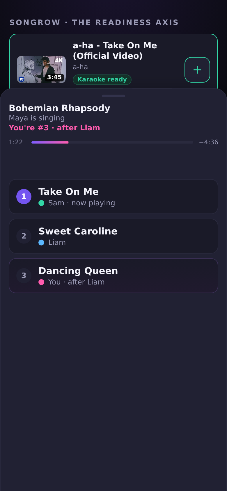

# Spike · QueueSheet on the shadcn/vaul drawer

> **⚠ SUPERSEDED — this document is history, not a plan.** Its verdict ("GO on the drawer") was
> never acted on, and the question it answered is closed the other way: the ratified phone design has no
> drawer; direction A built the inline-rows/hero/docked-band home instead, and neither `QueueSheet.svelte` nor
> the `QueueSheetDrawer.svelte` port ever rendered anywhere a guest could reach — both existed only in
> the `/components` gallery. An earlier change deleted the whole drawer surface along with `vaul-svelte`, `bits-ui`
> and `@internationalized/date`. The file:line citations below are left UNREPAIRED on purpose: the files
> are gone, so there is nothing to re-point them at, and the measurements are kept because they are the
> evidence for the decision. The band contract these numbers circle around survives as `--dock-h` on
> `.cta-dock` / `.search-dock` in `routes/+page.svelte`.

**Verdict: GO on the drawer, with two costs to accept and one number that will change.** All four
do-not-regress values hold exactly on the port, snap points work under a real pointer drag, and the
motion is CSS. What the port costs is guard coverage (already ruled on: Q1 · C) and a sheet that
is always 82dvh tall instead of shrink-wrapping its content.

Measured on `d325c64`, branch `spike/queuesheet-shadcn-827`, `vaul-svelte@1.0.0-next.7` +
`bits-ui@2.19.1`, headless Chromium 151.0.7922.10 at 390×844 DPR2 and 390×480 DPR2.

Reproduce:

> **The file this spike measured no longer exists.** `drawer-spike-827.test.ts` was deleted with the
> dead drawer surface it pinned. The command below is kept verbatim because this document is a record
> of a measurement that was taken, not an instruction to re-run it — repointing it at a file that
> never held these numbers would make the record false rather than current.
```bash
cd . && bun run build
ENCORE_EPHEMERAL=1 PORT=5271 HOST=127.0.0.1 bun run ./server.ts &
EPORT=5271 bun tests/e2e/probes/spike827-queuesheet-drawer.mjs      # 17/17
bun test src/lib/components/drawer-spike-827.test.ts # 5/5
```

## The four numbers

Both variants rendered in the same browser session, at the same viewports, with the same instrument.
The env() terms are measured against a real 34px bottom inset pushed in through
`Emulation.setSafeAreaInsetsOverride` — without one, `calc(10px + env(safe-area-inset-bottom, 0px))`
measures 10px whether the term is present or was deleted, so a headless run with no override cannot
tell the contract from its absence. Column pairs read `inset 34 / inset 0`.

| # | Number | Incumbent | Port | |
|---|---|---|---|---|
| N1 | `max-height: 82dvh` | 692.08px = 0.8200 dvh | 692.08px = 0.8200 dvh | ✅ exact |
| N2 | `.peek` `calc(10px + env(safe-area-inset-bottom))` | 44 / 10 | 44 / 10 | ✅ exact |
| N3 | `.body` `calc(20px + env(safe-area-inset-bottom))` | 54 / 20 | 54 / 20 | ✅ exact |
| N4 | `--peek-h`, and who outranks whom | 164px @844, 151px @480 — the inline write, not the media rule | 164px / 151px, same writer | ✅ exact |

N4 is the one worth reading twice, and the issue states it in a way the measurement corrects.
`app.css:162` declares `--peek-h: 132px` and `routes/+page.svelte:1968-1970` overrides it to `84px`
under `@media (max-height: 480px)`. The value the page actually resolves is **neither**, because
`QueueSheet.svelte:60` writes the measured peek height inline on `documentElement` and an inline
property outranks any media query. Measured: 164px at 844 tall and 151px at 480 tall — the 84px rule
never wins while the sheet is mounted. The port keeps that contract intact, including the unmount
teardown (§14).

Two corrections to how the issue frames N4, both measured by removing the inline property and
re-reading the cascade (deterministic, no racing hydration):

- **The 84px override is route-scoped, not global.** It lives in `routes/+page.svelte`'s own `<style>`,
  so it compiles into the phone route's stylesheet only. On `/join` at 480px tall the token measured
  **132px**, not 84px. With the inline writer removed, the phone route gives 132px at 844 tall and
  **84px** at 480 tall — so the rule is real, just not everywhere.
- **84px is a pre-measurement value, not a steady state.** The rule's own comment says so: a smaller
  fallback "still buys rows before that measurement lands". It is what the phone route paints with in
  the window between first paint and the sheet publishing its measured height.

## Go / no-go per risk

**Risk 1 · snap points — GO, and confirmed by gesture, not by types.** `snapPoints` accepts px
strings (`use-snap-points.svelte.js:44`), which is what makes a *content-measured* peek expressible
at all: 132px is 15.6% of an 844px phone and 27.5% of a 480px one, so a fraction is the wrong unit
for the peek and a fraction-only API would have been the no-go. A real trusted pointer drag of 200px
up from the peek moved the sheet top from 680px to 151.92px — the 0.82 snap, to within 0.08px — with
vaul reporting 20 drag events and one release.

One timing property found the hard way, recorded because it looks exactly like a no-go: `shouldDrag`
(`use-drawer-root.svelte.js:93`) returns false for any gesture starting within **500ms of the
drawer's own `openTime`**, and latches that for the whole gesture. The first probe run dragged at
700ms after mount, and the port reported 20 drag events with **0px of movement** — silently ignored.
At 1.5s the identical drag lands the snap point. The incumbent has no such window.

**Risk 2 · CSS-driven motion — GO on the collision question, with a caveat on reach.** Zero
`svelte/transition` / `svelte/animate` imports and zero `in:` / `out:` / `animate:` / `transition:`
directives anywhere in the shipped drawer, so there is **no collision with `motion.test.ts`**'s ban.
The animated properties are `transform` and `opacity` only, so the layout-property ban would also be
satisfied — if it could reach them. It cannot: the rules live in a 291-line `<style global>` at
`dist/components/drawer/drawer.svelte:92-383` inside `node_modules`, which `test-helpers.ts:36`'s
`SKIP_DIRS` skips by name, plus inline styles written from JS. This is now asserted rather than
asserted-in-prose, in `src/lib/components/drawer-spike-827.test.ts`.

**Risk 3 · the four numbers — GO. All four match exactly.** See the table.

**Risk 4 · drag reorder — OUT OF SCOPE.** The drawer is the *sheet pull*, which the incumbent already
implements with pointer handlers. Row reorder is `svelte-dnd-action` (`docs/ux/02-phone.md` XR-PH-06)
and the reorder-mode work owns it. Its "blocked" premise does not hold — different library, different gesture.

**Risk 5 · do the guards keep working — NO, as already ruled (Q1 · C).** Confirmed, and narrowed.
The port takes exactly two named assertions out of scope, and **both fail loudly**, which is the good
case: `design-system.test.ts`'s `caps.length > 0` (the dvh sheet-cap scan) and its non-null `.peek`
rule match (the env() scan). Neither can pass vacuously. The ruling is recorded **in advance** in
`non-vacuity-floors.test.ts`'s `PENDING_RULING` — **re-anchor, do not delete**, because the spike
proved the values are still true on the port; only their address changes. `RETIRED` is the wrong home
for it: nothing is being given up.

The spike also found the silent half is narrower than feared in one direction and wider in another:

- A `class=` string handed to a **component** is a prop, so Svelte never stamps its scope hash on it
  and a scoped rule matches nothing. The port's two rules that style the drawer's own elements
  (`Drawer.Content`, `Drawer.Handle`) must therefore be `:global`. `:global` blocks still parse, so a
  guard resolving a class name to its rule survives — but the same edit under shadcn's copy-in
  replaces them with `class="max-h-[82dvh]"`, which has **no rule to find**.
- Adding `QueueSheetDrawer.svelte` to the dvh-cap guard's file list was enough for it to cover the
  new component, so the mechanism is sound as long as the values stay in a `src/` `<style>` block.

`docs/DECISIONS.md`'s rationale — *"copy-in puts component CSS in `src/`, where the source-scan design
guards can still see and edit it"* — is **false for this component** and has been amended in place
rather than left standing.

## What changes that is not one of the four numbers

**1. The expanded sheet stops shrink-wrapping.** vaul supplies no positioning; it only writes
`transform`, and its snap offset is `containerHeight − snapHeight`, which reveals the element's own
top `snapHeight` pixels **only if the element is top-anchored and viewport-tall**. `.sheet-surface` in
`app.css` is the opposite (`bottom: 0`, content height). Composed as-is, the port measured **0px of
peek on screen** — translated 680px below a viewport it already sat at the bottom of. Overriding
`top`/`bottom`/`height` fixes it, at a price: with a 3-row queue the incumbent's expanded sheet is
**415px** and the page shows through above it; the port's is **692.08px**, the cap now binding, with
~277px of empty `--card2` below the last row.

| | Incumbent (415px) | Port (692.08px) |
|---|---|---|
| |  |  |

That is a design change, not a bug, and it is not decided here. It also means `.sheet-surface` stops
being genuinely shared, so the next sheet added to it inherits an anchoring the drawer does not use.

**2. The transition slows from 0.28s to 0.5s, and cannot be configured.**
`TRANSITIONS.DURATION = 0.5` and `EASE = [0.32, 0.72, 0, 1]` are module constants in
`dist/internal/constants.js` with no prop to override them. The **curve matches the incumbent's
exactly**; the duration is 1.79× longer. Measured computed `transition-duration`: incumbent `0.28s`,
port `0.5s`.

**3. `vaul-svelte` does not declare `bits-ui`, the package its own accessibility layer imports.** Nine
dist files `import … from "bits-ui"`, and `package.json` declares only `runed` and `svelte-toolbelt`,
with no `peerDependencies` entry. `bun add vaul-svelte` alone produces a package that cannot resolve
its own imports — verified: `Cannot find package 'bits-ui'`. The adopting commit must pin `bits-ui`
itself, with nothing upstream stating a compatible range. `1.0.0-next.7` published 2025-03-24 and is
still the newest.

**4. A ported QueueSheet cannot be loaded by `bun test`, so the mount rung goes dark on it.**
This is the sharpest cost the spike found, and it was not on the issue's list.
`vaul-svelte`'s `exports["."]` declares only `types` and `svelte` — **no `default`, no `import`, no
`require`**. Vite/SvelteKit apply the `svelte` condition, so the app builds; `bun test` does not, so
the specifier resolves to nothing and the failure reads as `Cannot find package 'vaul-svelte'` — an
install problem, seemingly, while the build is green. `mount-rung.test.ts` imports every component
that imports a `$app/*` module, and `routes/+page.svelte` both imports one and renders QueueSheet, so
a real port takes the mount rung dark on the phone's densest surface. Compare `bits-ui@2.19.1`, which
ships `default` alongside `svelte` and loads fine.

Measured remedy: **`bun test --conditions=svelte`** — the whole suite passes with it. That changes the
repo's single gate command for every contributor and for CI, which is why this spike reports it rather
than doing it. Two cheaper-looking fixes were tried and do not work: a preload `build.module()` alias
handles `vaul-svelte` but the chain continues into `svelte-toolbelt` and `runed`, both installed at
**two versions** here (vaul's and bits-ui's), so a by-specifier map cannot tell them apart; and
`build.onResolve` is never consulted for these imports (measured — the callback does not fire).
This is why the spike's gallery reads its query flag from `location` rather than `$app/state`: that
one import would have dragged the route into the mount rung and reddened the gate.

**5. The collapsed peek becomes a permanently-open dialog.** vaul's `Content` is a bits-ui
`Dialog.Content`, unmounted at `open={false}`. The peek must be on screen at all times, so it cannot
be the closed state: the port runs `open` permanently true at the first snap point, with
`modal={false}` and `dismissible={false}` so the page behind stays interactive and Escape does not
tear the peek off screen. Worth a deliberate a11y read before adoption — this spike did not measure
the assistive-technology consequences of a dialog that is never closed.

## What this spike did not measure

- Real iOS Safari. The env() terms were measured against a **synthetic** inset via CDP, which
  exercises the CSS resolution but not the device.
- Tailwind, and therefore shadcn's actual copy-in. The port keeps the incumbent's own CSS in `src/`
  deliberately, so risk 5 could be tested at its most favourable; a real shadcn drawer would replace
  those rules with utilities, which is strictly worse for every class-name-resolving guard.
- The a11y consequences of the never-closed dialog (see above).
- Two follow-ups are both still open and both rewrite `.body`, the surface N3 measures. These
  numbers are true of `d325c64` and will need re-measuring after either lands.
