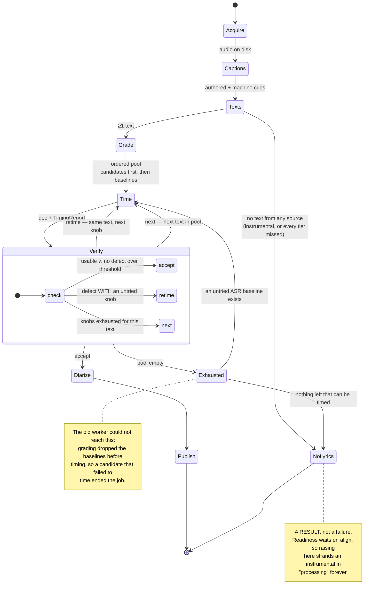

# new-worker

A rewrite of `worker/` as **durable workflows** rather than a linear pipeline.

The old worker is a flat list of steps walked top to bottom (`runtime/plan.py`: *"A plan is a list of
steps, executed linearly"*), with an `Outcome` of exactly `{CONTINUE, STOP}`. Nothing can loop back and
nothing can re-run a step with different parameters. Both of the failures this rewrite exists to fix
need exactly that, so this is the "revisit trigger" the old module docstring anticipated.

It runs on [DBOS](https://docs.dbos.dev/) — durable execution as a **library**, defaulting to a local
SQLite file. No server to host. Every `await` in a workflow is a checkpoint, so a worker that dies
mid-alignment resumes at the step it was on instead of redoing the ASR pass.

---

## The two defects this fixes

Both were traced in the old worker before starting.

**1. Lyrics are sometimes never selected.** `select_by_baselines` falls back to `baselines[:1]`, which is
`[]` when no baseline ran, so `publish` comes back empty; `TimeTexts` then raises a **retryable**
`RuntimeError`, costing three full ASR+align passes that cannot possibly differ, then failing
permanently. Worse, grading narrows the pool to a single winner and discards the ASR baselines before
timing — so when the chosen candidate fails to time, there is no second attempt even though a text with
word timings already measured on this exact audio was available.

**2. Lyrics are sometimes out of sync.** Everything needed to detect this is already computed and then
thrown away. `TimingReport` carries `overshoot_sec` (the "song ends mid-lyrics" signal), `coverage`,
`out_of_order`, `long_gaps`, `smeared`, `flashed`; `estimate_lrc_shift` carries a residual. Their only
consequence is a log line and one binary word→line degrade. Nothing re-aligns.

Plus a third found on the way: with no baseline available, `winner_suspect` is `False` because
`coverage is None`, so a wrong-song LRCLIB match publishes at full confidence, unchecked.

---

## The align state machine



`Failed` is deliberately absent from the lyric paths. It is reachable only from infrastructure faults —
audio that will not download, a missing model, a corrupt file. **No lyric outcome is a job failure**; the
floor is `NoLyrics`, and it is a success terminal.

### The retime knobs

`Verify` turns a defect into the next thing to try. Each is a parameter that already exists at a call
site in the old worker; the only new thing is being able to go back and change it.

| Signal | Threshold | Knob |
| --- | --- | --- |
| LRC residual after alignment | `SUSPECT_RESIDUAL_SEC = 2.0` | re-estimate the shift against the **aligned output** rather than the pre-align baseline |
| `coverage` below floor | `MIN_COVERAGE = 0.80` | swap align audio: vocals stem → full mix (a stem with bleed or over-suppressed vocals is a known coverage killer) |
| `overshoot_sec` over limit | `OVERSHOOT_FRACTION_MAX = 0.10` | drop the presplit `align_windows` and search the raw segments — a too-tight window from a mis-placed LRC confines whisperx's crop |
| `out_of_order > 0` | any | degrade to line sync (today's behaviour, now an explicit terminal transition) |
| all knobs tried | — | next text in the pool |

Ordering matters: the shift re-estimate is cheapest and highest-yield for out-of-sync, so it goes first.

---

## Layers

```mermaid
flowchart TD
    T[transport/<br/>websocket, reconnect, keepalive] --> W[workflows/<br/>@DBOS.workflow — pure orchestration]
    W --> S[steps/<br/>@DBOS.step — thin I/O shells]
    S --> D[domain/<br/>pure functions over data]
    S --> A[adapters/<br/>whisperx, demucs, pyannote, yt-dlp]
    D --> H[host/<br/>hardware, config, model dirs]
    A --> H
    P[protocol/<br/>wire frames, zero deps]
    T --- P
    W --- P
```

Dependencies point down only. `domain/` must not import `dbos`, `asyncio` or `torch` — it is the most
valuable code in the old worker (grading, validation, presplit, key detection) and the part that ports
over essentially unchanged. A test enforces the import graph, as `test_worker_layers.py` and
`test_lyrics_import_graph.py` do today.

Every `torch` import lives in `adapters/`, behind a `Protocol` in `adapters/ports.py`, so the suite runs
with no ML installed (`uv sync --only-group dev`).

### What DBOS deletes

Steps have serialized inputs and outputs, so the dataflow **is** the function signatures. That removes
the entire `Ctx` god-object along with `reads`/`writes` declarations, `validate_plan`'s dataflow check,
`STRICT_WRITES`, `_snapshot` and `_assert_declared_writes` — roughly 120 lines of runtime reflection
replaced by types mypy checks statically. The god-object was the real architectural smell, more than the
linear plan was.

Two constraints in exchange: steps return JSON-serializable values only (refs and paths into the media
dir, never bytes or tensors — already how this worker behaves), and workflow bodies must be
deterministic, so `time.time()` and every other side effect moves into a step.

---

## Durability and ownership

DBOS gives **process-level** durability. The SQLite file is local to the worker box.

```mermaid
stateDiagram-v2
    direction LR
    [*] --> Running
    Running --> Resumed : worker process restarts<br/>DBOS recovers from last step
    Resumed --> Reconcile
    Running --> Orphaned : box gone; core requeues<br/>to another worker
    Reconcile --> Running : core confirms we still own this job
    Reconcile --> Cancelled : core reassigned it — abandon,<br/>do not publish
    Orphaned --> [*]
```



The one genuinely new problem: a recovered workflow may no longer own its job, because the core's reaper
requeued it on `LEASE_EXPIRED` and another worker may already be running or finished it. So **the
transport re-checks ownership on reconnect and cancels orphaned workflows before they can publish**. The
core already holds `workerId` on the job row, which is the authority; DBOS exposes `executor_id` on the
worker side.

This is why publication is the last step and nothing before it is externally visible.

---

## Protocol

The wire contract is **co-designed**, not inherited — the old one reports a coarse `Stage` plus a
percentage, which cannot express "re-aligning, attempt 2, vocals→mix". Frames:

| Frame | Direction | Carries |
| --- | --- | --- |
| `worker:hello` | worker → core | capabilities, version, concurrency, backend (torch/mlx), device |
| `job:assign` | core → worker | job id, media id, action, params, media dir |
| `job:accept` | worker → core | acknowledgement, or a refusal with a reason |
| `job:state` | worker → core | **new** — state name, attempt, active knob, and the verdict that caused the last transition |
| `job:progress` | worker → core | stage + pct, for the phone's bar |
| `job:complete` | worker → core | artifacts, facts, selection, and the full decision trail |
| `job:failed` | worker → core | error, and whether it is retryable |

`job:state` is the point. "Why did this job publish these lyrics" is currently `ctx.note()` printed to
stdout, and the old code notes the process log rotates. Making the decision trail a wire frame puts it
on the job row where `/metrics` and the operator can read it.

---

## Development

```bash
uv python install 3.12        # worker boxes ship older interpreters; uv fetches a pinned one
uv sync --only-group dev      # gates only: no multi-GB torch download
uv run pytest
uv run ruff check . && uv run ruff format --check .
uv run mypy

uv sync --extra cpu --extra ml --extra text    # to run real jobs on CPU
uv sync --extra cu124 --extra ml --extra text  # on an NVIDIA box
```

`cpu` and `cu124` are declared mutually exclusive in `[tool.uv]`, which is what lets one lockfile hold
both resolutions. The pins are identical between them; only the wheel index differs, so switching
backends cannot silently move a model version.

---

## Status

Scaffold only. Nothing is implemented. `worker/` remains the live worker and is untouched.
