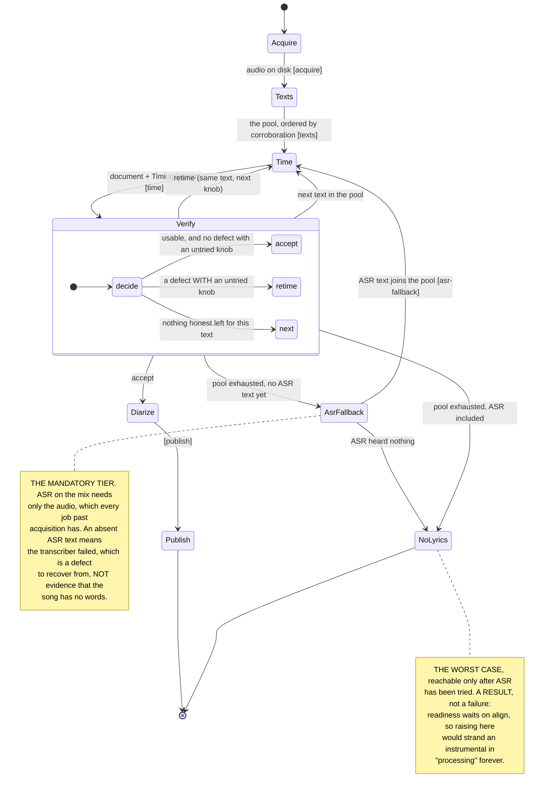
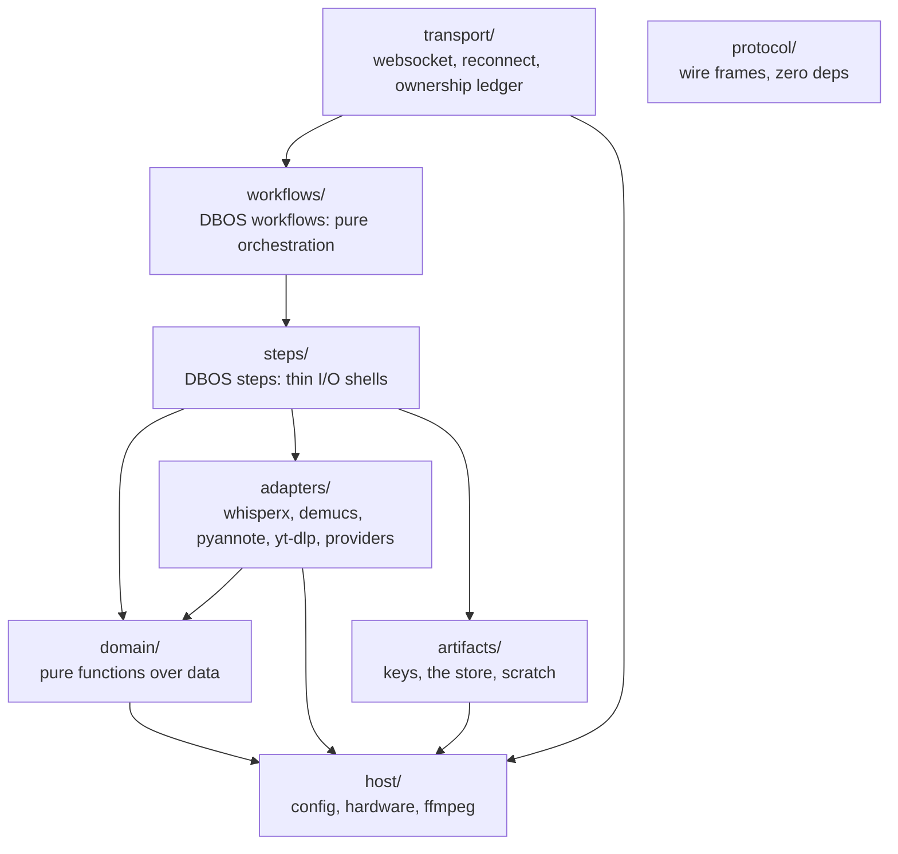

# worker

Encore's processing worker. It dials the core over a websocket, takes jobs (`fetch`, `stems`,
`stems-upgrade`, `align`), and publishes what they produce into the shared media directory: the audio, the
separated stems, and timed lyrics.

`align` and `stems` run as [DBOS](https://docs.dbos.dev/) workflows; `fetch` does not, because one
download is cheaper to retry than to checkpoint. DBOS is durable execution as a **library**, backed by a
local SQLite file, so there is no server to host. Only align's steps are checkpoints: a worker that dies
mid-alignment resumes at the step it was on and does not redo the ASR pass, while a stems run records no
steps and separates again. The align job is a state machine, not a linear pipeline, because it has to loop
back. It re-times the same text with a different parameter, moves to the next text, or runs ASR on demand.

> **Where the rest is written down.** This file is the operator's tour: the state machine, the knobs, the
> settings, the suites. The **design** (what each mechanism is for, what must not break, what was measured
> and rejected) is in two documents. The code points at them rather than repeating them.
>
> | Document | Covers |
> | --- | --- |
> | [`../docs/arch/04-alignment.md`](../docs/arch/04-alignment.md) | the decode, the repair ladder, the gates (lexical lift, envelope, LINE_SYNC, calibration by model), grading, the claim clock, text hygiene, word ends, and the `XA-NN` invariants (§12) |
> | [`../docs/arch/05-worker.md`](../docs/arch/05-worker.md) | layers, separation and the measured stem roles, the audio profile, artifacts and scratch, ffmpeg, providers, transport and ownership, durability, configuration, and the `XW-NN` invariants (§10) |
>
> Every **measurement** (sweeps, per-song readings, threshold fits, benchmark history) is in
> [`../docs/benchmarks/forced-alignment/LOG.md`](../docs/benchmarks/forced-alignment/LOG.md) (current numbers in its
> [`README.md`](../docs/benchmarks/forced-alignment/README.md)) and
> [`../docs/benchmarks/stem-separation/README.md`](../docs/benchmarks/stem-separation/README.md).

---

## The align state machine

`workflows/align.py` (`run_align`). The state names in brackets are the workflow's own `job:state` names.
The timing step also reports `align-global`, `align-windowed`, `align-line-sync` and `align-language`.



**No lyric outcome is a job failure.** The floor is `NoLyrics`, and it is a success terminal. A job fails
on an infrastructure fault (audio that will not download, a missing model, a device fault or
out-of-memory, audio ffmpeg will not decode) or on a refused publish (see below). Alignment raises the
faults as `adapters.ports.InfraFault` with the fault's own `retryable`, rather than declining attempt after
attempt and ending in a `NoLyrics` that nothing measured (XA-17).

When the core requeues a job whose run failed, was cancelled, or abandoned its publication, DBOS would
answer that workflow's id with what it recorded. So the worker runs a deterministic fork of it
(`{job}~requeue-{n}`, `workflows/durable._run_id`): align resumes from the step that failed, stems separates
again (05-worker.md §8, §8.1). A failed job also leaves nothing in the lyrics store. Every attempt is staged
in job scratch, and `publish` places them only after its ownership check (XA-13).

Within a run, DBOS retries only two align steps, and only on a retryable fault: `acquire_audio` gets 3
attempts, `fetch_provider_lyrics` 2, every other step 1 (`workflows/dbos_align.py`). If DBOS is not
installed or fails to start, the worker logs it and runs every job without durability.

### The fallback ladder

Three tiers, tried in order of *authority* rather than of expected quality (`domain/lyrics/policy.py`,
`Tier`):

| Tier | What it is | Why here |
| --- | --- | --- |
| `CANDIDATE` | a provider's lyrics sheet (LRCmux, LRCLIB), or the upload's authored caption track | A real lyrics sheet is the best answer when it is right |
| `ASR` | Whisper, on the vocals stem, then the mix | **The mandatory fallback.** Less likely to have the right words, but it cannot be the wrong song or misplaced in time, because it came from this audio |
| `MACHINE` | YouTube's automatic caption track | The same kind of evidence as ASR, measured worse |

A pool with no ASR entry has not earned the right to conclude that the song has no words.
`policy.asr_is_mandatory()` is that check. When it fails, the workflow runs ASR on demand instead of
terminating. A job whose first candidate times well never loads a speech model, because forced alignment
is itself the wrong-song detector.

### What the job asks for

The align params, each read by one pure function in `steps/api.py`:

| Param | Honoured as |
| --- | --- |
| `pinnedRef` + `pinnedText` | A **paste**: the only text, untimed, decoded blind. A person chose it, so it is never judged a wrong text. If a wrong-text gate would refuse it, it publishes with every line graded `low` (`pin-unvouched` on the trail) and is reported with `vouched: false`. It is published under the manual key `derived/lyrics/{id}-manual-word.json` (`keys.manual_lyrics_key`, core's `manualLyricsRef`) |
| `pinnedRef` alone | A **re-pick**: the stored candidate's words, re-timed blind (its old timings are not read), written back under the same ref with its label intact |
| `syncMode` | `forced` (the default) or `lines`. `lines` publishes no word timing: each text's only attempt is its own line timings through the gated LINE_SYNC rung (04-alignment.md §5.3). It is honoured only where there is a vocals stem, and never for a pin |
| `asrModel` | The whisper checkpoint the ASR fallback loads: one of `host.config.ASR_MODELS`, else the worker's default, with the fallback on the trail |
| `language` | The job's language when a text does not carry its own; `en` if neither does |

**A pinned job never falls back.** Only the accepted attempt is placed at the pinned ref. A pin that
cannot be timed publishes nothing: no other text and no ASR, so the lyrics the core already holds stay as
they are (`pin-declined` on the trail). A ref outside `derived/lyrics/*.json` is refused unread.

### The retime knobs

`policy.decide` turns a defect into the next thing to try (`Knob`). The thresholds are in
`domain/lyrics/report.py`.

| Signal | Threshold | Knob |
| --- | --- | --- |
| the attempt is unusable (nothing timed, or words out of order) | — | `line-sync`: publish the text's own line timings, through their own gate |
| residual offset after placement | `SUSPECT_RESIDUAL_SEC = 2.0` | `reshift`: re-place the text against the **aligned output** |
| timings run past the end of the audio | `OVERSHOOT_FRACTION_MAX = 0.10` of the duration | `drop-windows`: search the raw segments rather than presplit's windows, else `reshift` |
| coverage below the floor (windowed engine only) | `MIN_COVERAGE = 0.80` | `align-on-mix`: vocals stem → full mix |
| nothing relates the decode to the text's claimed line starts | — | `line-sync` |
| a gate refused the text | — | next text in the pool |
| no untried knob addresses the defect | — | accept, with "accepted DESPITE …" on the trail |

The default global engine reads only `line-sync`; the other knobs are the windowed engine's
(`policy._READS`).

### How a text gets its timings

Timings are evidence, never instructions. The default `time` path computes the song's CTC emission matrix
once (cached; for English the `HUBERT_ASR_LARGE` bundle on every device, `adapters/ml.py`), then force-aligns the text globally: no search windows, and no trust in the text's
own timings. In order:

- **Text hygiene.** Every source is cleaned at its adapter boundary (`domain/lyrics/clean.py`): markup,
  entity-escaped markup, per-word timestamp spans, music-note decoration, speaker dashes. It deliberately
  does not decide whether a line is a lyric. That needs the audio, and the never-sung rule measures it
  (04-alignment.md §8).
- **The lexical lift** asks, on the emission matrix alone, whether these are the words sung (§5.1).
- **The global decode** gives lines, words, syllable spans and per-line scores (§3, §3.1).
- **The claim clock** puts the text's claimed timings on this recording's clock, once, when that explains
  enough lines (`domain/lyrics/claimmap.py`, §7). Then `domain/lyrics/reconcile.py` compares them with the
  decode, and disagreement is repaired in place: a re-decode of the same matrix inside a window other
  evidence vouches for (§4).
- **The envelope gate** asks whether there is singing where the text says (§5.2).
- **Word ends** are a display post-pass, on a vocals stem only. Each end is held while the singing goes
  on, and starts never move (`domain/lyrics/ends.py`, §10).

The windowed whisperx aligner survives as a capability fallback, for a language with no CTC model, and
for the LINE_SYNC rung. `reshift` and `drop-windows` parameterise that windowed search.

---

## Layers



Dependencies point down only, and every layer but `host/` may import `protocol/`. `tests/test_layers.py` enforces the
graph (`ALLOWED`) by walking every module's imports. `domain/` may not import `dbos`, `asyncio`, `torch` or
any model library. Heavy ML imports are written *inside a function* (`tests/test_ml_devices.py`), so a
box with no ML still imports the adapters, resolves its capabilities, and declines the work instead of
crashing at startup. The full rules are in 05-worker.md §1.

Steps have serialised inputs and outputs, so the dataflow **is** the function signatures, and mypy checks
it. The exchange is two constraints. Steps return JSON-serialisable values only: refs and paths into the
media dir, never bytes or tensors. And workflow bodies must be deterministic, so every side effect,
`time.time()` included, lives in a step. `stems` has no fallback ladder and reads top to bottom
(`workflows/stems.py`). Its workflow records no steps, so a crash after separation separates again.

---

## Durability and ownership

DBOS gives **process-level** durability. The SQLite file (`ENCORE_DBOS_DB`) is local to the worker box and
must not be shared.

```mermaid
stateDiagram-v2
    direction LR
    [*] --> Running
    Running --> Reconcile : socket drops and reconnects
    Reconcile --> Running : core confirms we still own this job
    Reconcile --> Cancelled : core reassigned it: stop,<br/>do not publish
    Running --> Resumed : worker process restarts<br/>DBOS recovers the workflow
    Resumed --> Cancelled : not in the new process's ledger:<br/>publish fails closed
    Running --> Orphaned : box gone; core requeues<br/>to another worker
    Running --> Publish : work complete
    Publish --> Committed : ownership re-asserted
    Publish --> Cancelled : lease lost DURING the work
    Orphaned --> [*]
    Cancelled --> [*]
    Committed --> [*]
```



A running workflow may stop owning its job: the core's reaper requeues a job whose lease expired, and
another worker may already be running it or be finished with it. So publication is guarded, at two points:

1. **The transport claims jobs** (`job:claim`): on `job:assign`, and on reconnect, before it serves
   anything, for every job in its ownership ledger (`transport/ownership.py`). It stops the ones the core
   answers `revoked`. An `unknown` answer is logged as `DESYNC` and forbids the publish, but does not stop
   the work. The core holds the job's `workerId`, and that is the authority. The ledger is in memory and
   holds only jobs this process accepted, so a workflow DBOS recovers after a restart is never claimed and
   its publish is refused.
2. **`publish` re-asserts ownership as its first act**, immediately before it writes
   (`confirm_ownership`, raising `NotOurJob`). It re-claims first only if the job is unconfirmed. This is
   not redundant with (1). A lease can expire *during* a long alignment, and a check that ran only at
   reconnect would leave exactly the window where two workers publish different lyrics for one song.

So **nothing before `publish` is externally visible, and `publish` is the only step that can be refused
for a reason unrelated to the work.** A refused publish is sent as a retryable `job:failed`, for every job
type; the core ignores it once the job is another worker's. Details: 05-worker.md §7, §7.1, §8.

---

## Protocol

Every frame is a frozen dataclass in `protocol/frames.py`. Shared string values (actions, stages, sync
modes, capabilities) are in `protocol/vocabulary.py` and mirror the core's TypeScript contract.

| Frame | Direction | Carries |
| --- | --- | --- |
| `worker:hello` | worker → core | worker id, capabilities, concurrency, version, host info. Also the separator backend and `ENCORE_DEVICE` (absent when auto-detected), which core's contract drops |
| `worker:catalogue` | worker → core | the selectable separation models, sent after `hello` because enumerating them is slow; repeats the full capability set |
| `worker:heartbeat` | worker → core | free slots and the running job ids: on connect, and at the interval `welcome` names |
| `job:accept` | worker → core | the job was taken |
| `job:reject` | worker → core | the job was refused, with a required reason |
| `job:progress` | worker → core | stage + pct, for the phone's bar; also the lease keepalive. `etaSec` is declared, never set |
| `job:state` | worker → core | state name, attempt, active knob, and the verdict that caused the last transition |
| `job:complete` | worker → core | artifacts, facts (what actually ran), and the full decision trail. `selection` and `stages` are declared, never set |
| `job:failed` | worker → core | the error and whether it is retryable: an infrastructure fault, a refused publish (retryable), or an unknown action (not) |
| `job:claim` | worker → core | "do I still own these job ids?", after an accept, on reconnect, and before publishing an unconfirmed job |
| `worker:welcome` | core → worker | the heartbeat interval, the ack timeout, the media store, the container for published stems. The worker reads the interval and the container |
| `job:assign` | core → worker | job id, processing id, media id, job type, source URI, params |
| `job:cancel` | core → worker | the song left the queue (`core/src/lib/server/jobs/cancel.ts`) |
| `job:revoked` | core → worker | the core reassigned this job: stop, and do not publish |
| `job:claim-ack` | core → worker | the answer to a claim: `owned`, `revoked`, `unknown` |
| `ping` | core → worker | declared on both sides, not sent by core |

`job:revoked` and `job:claim` make the ownership guard implementable, and they are deliberately BOTH a push
and a pull. `job:revoked` closes the window continuously, which a poll cannot. `job:claim` exists because a
push is exactly what a disconnect loses, and a disconnect is the event that causes a reassignment.

`job:state` exists so that "why did this job publish these lyrics" is on the job row, where `/metrics` and
the operator can read it, rather than in a process log. `job:progress` stays coarse on purpose: a stage is
for a progress bar a singer is watching, a state is for an operator.

`frames.parse` raises `ProtocolError` on an unknown or malformed inbound frame; the client logs and skips
it and keeps the connection (`transport/client.py`, `_on_frame`). Wire conventions: 05-worker.md §7.

---

## Configuration

`Config.from_env` (`host/config.py`) is the only reader of the environment. An unknown backend, ASR model
or experiment name, a non-positive number (so `ENCORE_FLAC_LEVEL=0` too), or an uncalibrated
`ENCORE_ALIGN_MODEL` (`__main__.align_model_for`) is refused at startup with a message naming the variable
and the accepted values. A flag reads anything but `1`, `true`, `yes` or `on` as off.

| Variable | Default | Meaning |
| --- | --- | --- |
| `ENCORE_CORE_URL` | `ws://localhost:3000/ws?role=worker` | the core's websocket. The `/ws` path and `role=worker` are both required |
| `ENCORE_WORKER_TOKEN` | unset | the shared secret core checks on a `role=worker` upgrade; the same value on both sides. Never printed |
| `ENCORE_WORKER_ID` | `worker-` plus a stable suffix, e.g. `worker-3fa2c1` | this worker's id. Core treats a repeated id as the same worker reconnecting, so two live workers must never share one |
| `ENCORE_WORKER_VERSION` | `0.1.0` | the version sent in `hello` |
| `ENCORE_WORKER_CONCURRENCY` | `1` | jobs at once. Separation and alignment are both GPU-bound |
| `ENCORE_MEDIA_DIR` | `/media` | the shared media volume (core's `job:assign` names none) |
| `ENCORE_DBOS_DB` | `encore-worker.sqlite` | DBOS's durable state, per box |
| `ENCORE_SEPARATOR_BACKEND` | auto | `torch` or `mlx` |
| `ENCORE_DEVICE` | auto | the compute device, overriding the hardware probe |
| `ENCORE_ASR_MODEL` | `base` | the default whisper checkpoint: one of `ASR_MODELS` |
| `ENCORE_ALIGN_MODEL` | `HUBERT_ASR_LARGE` | the English alignment bundle, a torchaudio pipeline name with a calibration row |
| `ENCORE_ALIGN_EXPERIMENTS` | none | comma-separated names from `ALIGN_EXPERIMENTS`: most switch on an arm, seven switch off a default-on feature (04-alignment.md §14) |
| `ENCORE_FFMPEG_BIN` | best available | the ffmpeg to run (`host/ffmpeg.py`, 05-worker.md §5) |
| `ENCORE_YTDLP_BIN` | `yt-dlp` | the yt-dlp to run |
| `ENCORE_MLX_BIN` | `demucs-mlx` | the demucs-mlx to run |
| `ENCORE_ZOO_MODEL_DIR` | `$XDG_CACHE_HOME/encore-worker/separator-models` | where separator checkpoints are cached, deliberately not `/tmp` |
| `ENCORE_KEEPALIVE_SEC` | `10` | progress interval while a long step runs; must stay well under the core's progress lease |
| `ENCORE_JOB_CEILING_SEC` | `21600` | how long, from job start, the keepalive vouches for a job |
| `ENCORE_PUBLISH_STEM_FORMAT` | `flac` | a fallback only: core announces the live value in `welcome` |
| `ENCORE_FLAC_LEVEL` | `8` | FLAC compression level |
| `ENCORE_OFFLINE` | off | no outbound internet: skip the lyrics providers; captions and ASR still run |
| `ENCORE_LRCMUX_URL` | `https://api.lrcmux.dev` | the lyrics multiplexer, tried first |
| `ENCORE_LRCLIB_URL` | `https://lrclib.net/api/get` | the direct provider |
| `ENCORE_HTTPS_PROXY` | unset | an explicit proxy for provider lookups; unset falls back to the standard variables |

One variable is read outside `Config`: `ENCORE_ANNOTATE=0` switches off the MusicBrainz annotation (`adapters/musicbrainz.py`).

---

## Development

```bash
uv python install 3.12        # uv fetches a pinned interpreter
uv sync --extra ffmpeg        # base + the dev group, as CI installs it: no torch download
uv run pytest -m "not ml"     # the fast suite
uv run ruff check . && uv run ruff format --check .
uv run mypy

uv sync --extra cpu --extra ml --extra text --extra romanize --extra nonlatin    # real jobs, CPU
uv sync --extra cu128 --extra ml --extra text --extra romanize --extra nonlatin  # on an NVIDIA box
```

The extras (`pyproject.toml`): `cpu` / `cu128` pick the torch wheel index, `ml` is the model stack, `mlx`
the Apple-silicon separators, `audiosep` the separator zoo, `ffmpeg` a bundled ffmpeg, `text` text
extraction and language identification, and `romanize` + `nonlatin` the non-Latin lane. `dev.sh` and
`docker/worker.Dockerfile` both install `romanize` and `nonlatin`. Without them `build_romanizer` answers
None, so no CJK line gains its second script, and the per-language stage-2 table cannot route zh or ko to
MMS_FA (04-alignment.md §9.2). They stay extras so the CI install (`uv sync --extra ffmpeg`) has neither,
which is the configuration the hermetic tests assert the absent behaviour on. MMS_FA's CC-BY-NC attribution is
04-alignment.md §14.2.

`cpu` and `cu128` are declared mutually exclusive in `[tool.uv]`, which lets one lockfile hold both
resolutions. The pins are identical between them; only the wheel index differs, so switching backends
cannot silently move a model version. `tests/test_packaging.py` holds that and the other resolution
invariants as assertions, because each one is a workaround for a measured failure.

### The test suites

```bash
uv run pytest                 # everything; needs the `ml` extra for the model-backed tests
uv run pytest -m 'not ml'     # the fast suite: no torch, no models (CI runs this on every worker PR)
uv run pytest -m dbos         # through a real DBOS on temp SQLite (needs SQLite >= 3.42)
uv run pytest -m ml           # against real models and synthesised speech
```

`--strict-markers` is on. A mistyped marker is an error, not a warning, because `-m 'not ml'` silently
running a test that needs gigabytes of checkpoints looks like a broken test rather than a broken marker.
Anything a marked suite proves that the fast suite could also prove belongs in both, since `-m ml` is
deselected on every edit.

CI: `.github/workflows/ci-worker.yml` runs ruff, mypy and the fast suite on PRs that touch the worker or
the docs it cites. `.github/workflows/ml.yml` runs the whole suite, `ml` included, on a schedule.
`tests/test_docs_pointers.py` fails when a `docs/` path, section or title the code cites stops existing.

---

## Running it

```bash
uv sync --extra cpu --extra ml --extra text --extra romanize --extra nonlatin  # or cu128 / mlx
ENCORE_CORE_URL=ws://localhost:3000/ws?role=worker uv run python -m encore_worker
```

`dev.sh` at the repo root runs the core and the worker together, and `docker/compose.yaml` runs the worker
image (`docker/worker.Dockerfile`) against `ws://core:3000/ws?role=worker`. `dev.sh` installs `cu128` torch by
itself on Linux x86_64 when `nvidia-smi -L` sees a GPU, else `cpu`; `ENCORE_TORCH_EXTRA=cpu|cu128` overrides it,
and also the `cu128` that `./dev.sh compose --cuda` builds by default. Linux aarch64 with NVIDIA (GH200, DGX
Spark) stays `cpu` by choice, because the lock carries `cu128` wheels for x86_64 only.

YouTube needs two things outside `dev.sh` and the image, which set both up: [deno](https://deno.com) on PATH,
and the line `--remote-components ejs:github` in a yt-dlp config (`~/.config/yt-dlp/config`, or copy
`docker/yt-dlp.conf` there). Without them every YouTube song fails with "Requested format is not available",
and the worker prints a warning at boot.

A box with no capabilities still connects and says so rather than exiting. A process that vanishes leaves
an operator guessing, and the core simply routes nothing to it.
