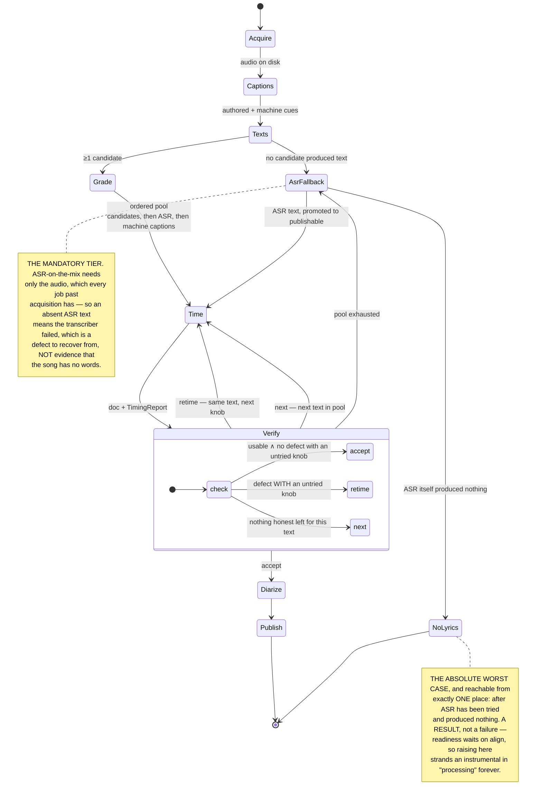
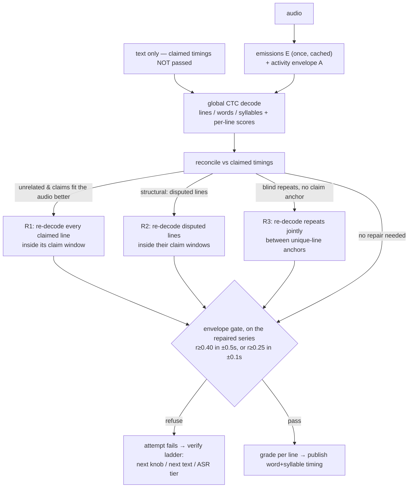

# worker

A rewrite of `worker/` as **durable workflows** rather than a linear pipeline.

The old worker is a flat list of steps walked top to bottom (`runtime/plan.py`: *"A plan is a list of
steps, executed linearly"*), with an `Outcome` of exactly `{CONTINUE, STOP}`. Nothing can loop back and
nothing can re-run a step with different parameters. Both of the failures this rewrite exists to fix
need exactly that, so this is the "revisit trigger" the old module docstring anticipated.

It runs on [DBOS](https://docs.dbos.dev/) — durable execution as a **library**, defaulting to a local
SQLite file. No server to host. Every `await` in a workflow is a checkpoint, so a worker that dies
mid-alignment resumes at the step it was on instead of redoing the ASR pass.

---

## The two defects this fixes

Both were traced in the old worker before starting.

**1. Lyrics are sometimes never selected.** `select_by_baselines` falls back to `baselines[:1]`, which is
`[]` when no baseline ran, so `publish` comes back empty; `TimeTexts` then raises a **retryable**
`RuntimeError`, costing three full ASR+align passes that cannot possibly differ, then failing
permanently. Worse, grading narrows the pool to a single winner and discards the ASR baselines before
timing — so when the chosen candidate fails to time, there is no second attempt even though a text with
word timings already measured on this exact audio was available.

**2. Lyrics are sometimes out of sync.** Everything needed to detect this is already computed and then
thrown away. `TimingReport` carries `overshoot_sec` (the "song ends mid-lyrics" signal), `coverage`,
`out_of_order`, `long_gaps`, `smeared`, `flashed`; `estimate_lrc_shift` carries a residual. Their only
consequence is a log line and one binary word→line degrade. Nothing re-aligns.

Plus a third found on the way: with no baseline available, `winner_suspect` is `False` because
`coverage is None`, so a wrong-song LRCLIB match publishes at full confidence, unchecked.

---

## The align state machine



`Failed` is deliberately absent from the lyric paths. It is reachable only from infrastructure faults —
audio that will not download, a missing model, a corrupt file. **No lyric outcome is a job failure**; the
floor is `NoLyrics`, and it is a success terminal.

### The fallback ladder

Three tiers, tried in order of *authority* rather than of expected quality (`domain/lyrics/policy.py`):

| Tier | What it is | Why here |
| --- | --- | --- |
| `CANDIDATE` | LRCLIB, or the upload's authored caption track | A real lyrics sheet is the best answer when it is right |
| `ASR` | Whisper, on the vocals stem or the mix | **The mandatory fallback.** Less likely to have the right words, but it cannot be the wrong song and cannot be misplaced in time, because it was derived from this audio |
| `MACHINE` | YouTube's automatic caption track | The same kind of evidence as ASR, measured worse |

**`NoLyrics` has exactly one inbound edge**, and it is from `AsrFallback`. A pool with no ASR entry has
not earned the right to conclude the song has no words: ASR-on-the-mix requires only the audio, and every
job past acquisition has that, so an absent ASR text means the transcriber failed or was never built.
`policy.asr_is_mandatory()` is that check, and the workflow runs ASR on demand rather than terminating.

The old worker inverted this. Grading narrowed the pool to a single winner and *discarded* the ASR
baselines before timing, so a candidate that failed to time ended the job — with a guaranteed-timeable
text sitting unused.

### The retime knobs

`Verify` turns a defect into the next thing to try. Each is a parameter that already exists at a call
site in the old worker; the only new thing is being able to go back and change it.

| Signal | Threshold | Knob |
| --- | --- | --- |
| LRC residual after alignment | `SUSPECT_RESIDUAL_SEC = 2.0` | re-estimate the shift against the **aligned output** rather than the pre-align baseline |
| `coverage` below floor | `MIN_COVERAGE = 0.80` | swap align audio: vocals stem → full mix (a stem with bleed or over-suppressed vocals is a known coverage killer) |
| `overshoot_sec` over limit | `OVERSHOOT_FRACTION_MAX = 0.10` | drop the presplit `align_windows` and search the raw segments — a too-tight window from a mis-placed LRC confines whisperx's crop |
| `out_of_order > 0` | any | degrade to line sync (today's behaviour, now an explicit terminal transition) |
| all knobs tried | — | next text in the pool |

Ordering matters: the shift re-estimate is cheapest and highest-yield for out-of-sync, so it goes first.

**A correction that runs BEFORE the first alignment, not as a knob** (on by default): a timed text is
fitted against the audio's own vocal-activity envelope (`domain/audio/activity.py`) and shifted onto this
recording's clock before whisperx ever sees it. Measured need: whisperx crops audio to each segment's
span, so an offset LRC passes through with unity gain — `bias = 1.005 × offset + 131 ms` over a 0–5 s
sweep — and the RESHIFT knob above cannot fix a first attempt, because its reference is the previous
alignment's own (equally offset) output. The fit recovers an injected offset to 10–20 ms on the vocals
stem and refuses a wrong song's sheet (envelope r gate). Full numbers:
`docs/benchmarks/forced-alignment/`.

### Alignment: the global decode

The `Time` step's default path, an inversion of the old one: **timings are evidence, never instructions.**
Instead of handing a text's timings to whisperx as its search windows, the worker computes the full
song's wav2vec2 emission matrix once (~4 s CPU, cached) and force-aligns the text globally — no windows,
no trust. Incoming timings are then *reconciled* against ours (`domain/lyrics/reconcile.py`): agreement
raises per-line confidence, disagreement is diagnosed (`offset` / `drift` / `structural` / `unrelated`)
and recorded on the trail, and an `unrelated` verdict is arbitrated by asking the audio which series
matches actual singing. The decode is char-level, so each word also carries **syllable spans** — the
sung durations a karaoke ball needs — grouped by a CMUdict→pyphen→naive syllabifier
(`domain/lyrics/syllabify.py`).



**Disagreements are repaired in place, never escalated to a different engine.** Every repair is a
re-decode of the SAME emission matrix inside a window some other evidence vouches for — a claim span, or
the gap between two trusted unique lines — so a repair costs milliseconds, keeps syllable spans, and a
failed repair keeps the original timing (`domain/lyrics/generate.regenerate`). A repaired line whose
window decode HEARD NOTHING (stuck at the window edge, or scoring far below the song's median) instead
**adopts the claim's own timing** at `low` confidence — measured on tfr-chosen's chopped-vocal outro,
where no decode can recognise words the captions time correctly. Every refusal lands a `job:state` trail
note with its reason and numbers — a silent one proved indistinguishable from the step never running.
Measured (claims present, vs authored captions): **0 gross errors on all three benchmark songs** (14→0
on tfr-chosen), flyaway 96.0% / mayday 94.2% of lines within ±250 ms after bias correction, ≥98% within
±500 ms raw. R3 (blind-repeat anchored re-decode) measured a no-op on real audio — kept as a cheap
guard; the real blind-repeat fix is future occurrence assignment.

Measured on `tfr-flyaway` against authored-caption truth: an UNTIMED sheet goes from **1.3% → 70.7%** of
lines within ±250 ms (the windowed path's spread-over floor is gone), and a deliberately offset LRC is
*diagnosed*, not obeyed. Blind repeats stay `low` confidence even after the anchored re-decode: an anchor
vouches for the region, not for which occurrence is which.

The **windowed whisperx aligner survives only as a capability fallback** — an aligner that cannot produce
an emission matrix at all (a language without a CTC dictionary model) — and for the LINE_SYNC terminal
knob. The RESHIFT and DROP_WINDOWS knobs parameterize that windowed search; the global engine never
reports a placement residual, so `policy.decide` never offers them against its documents. Measurements:
`docs/benchmarks/forced-alignment/README.md`.

---

## Layers

```mermaid
flowchart TD
    T[transport/<br/>websocket, reconnect, keepalive] --> W[workflows/<br/>@DBOS.workflow — pure orchestration]
    W --> S[steps/<br/>@DBOS.step — thin I/O shells]
    S --> D[domain/<br/>pure functions over data]
    S --> A[adapters/<br/>whisperx, demucs, pyannote, yt-dlp]
    D --> H[host/<br/>hardware, config, model dirs]
    A --> H
    P[protocol/<br/>wire frames, zero deps]
    T --- P
    W --- P
```

Dependencies point down only. `domain/` must not import `dbos`, `asyncio` or `torch` — it is the most
valuable code in the old worker (grading, validation, presplit, key detection) and the part that ports
over essentially unchanged. `tests/test_layers.py` enforces the graph by walking every module's imports —
and it found two real violations the first time it actually worked, a step importing a workflow and two
leaf layers importing each other. (Its first version was vacuous: it compared `dotted.split(".")[0]`,
which is `encore_worker` for every absolute import in the package, so it examined nothing and passed.)

Every `torch` import lives in `adapters/`, behind a `Protocol` in `adapters/ports.py`, and is written
*inside a function* — `tests/test_ml_devices.py` asserts that by AST, since it is what lets a box with no
ML import the adapter, resolve its capabilities and decline the work rather than crashing at startup.

### What DBOS deletes

Steps have serialized inputs and outputs, so the dataflow **is** the function signatures. That removes
the entire `Ctx` god-object along with `reads`/`writes` declarations, `validate_plan`'s dataflow check,
`STRICT_WRITES`, `_snapshot` and `_assert_declared_writes` — roughly 120 lines of runtime reflection
replaced by types mypy checks statically. The god-object was the real architectural smell, more than the
linear plan was.

Two constraints in exchange: steps return JSON-serializable values only (refs and paths into the media
dir, never bytes or tensors — already how this worker behaves), and workflow bodies must be
deterministic, so `time.time()` and every other side effect moves into a step.

---

## Durability and ownership

DBOS gives **process-level** durability. The SQLite file is local to the worker box.

```mermaid
stateDiagram-v2
    direction LR
    [*] --> Running
    Running --> Resumed : worker process restarts<br/>DBOS recovers from last step
    Resumed --> Reconcile
    Running --> Orphaned : box gone; core requeues<br/>to another worker
    Reconcile --> Running : core confirms we still own this job
    Reconcile --> Cancelled : core reassigned it — abandon,<br/>do not publish
    Running --> Publish : work complete
    Publish --> Committed : ownership re-asserted
    Publish --> Cancelled : lease lost DURING the work
    Orphaned --> [*]
    Cancelled --> [*]
    Committed --> [*]
```



The one genuinely new problem: a recovered workflow may no longer own its job, because the core's reaper
requeued it on `LEASE_EXPIRED` and another worker may already be running or finished it.

**DECIDED: publication is guarded.** Two layers, and both are needed:

1. **On reconnect, the transport re-checks ownership** for every workflow DBOS recovered, and cancels the
   ones the core has reassigned. The core holds `workerId` on the job row and that is the authority;
   DBOS exposes `executor_id` on the worker side.
2. **`publish` re-asserts ownership as its first act**, inside the step, immediately before it writes.
   Not redundant with (1): a lease can expire *during* a long alignment, so a workflow that was
   legitimately ours at reconnect can be reassigned before it reaches publication. A check that only
   runs at reconnect leaves exactly the window where two workers publish different lyrics for one song.

So the ordering rule is: **nothing before `publish` is externally visible, and `publish` is the only step
that can be refused for a reason that has nothing to do with the work it did.** A refused publish is not
a failure — the job belongs to someone else now, and that is a normal outcome.

---

## Protocol

The wire contract is **co-designed**, not inherited — the old one reports a coarse `Stage` plus a
percentage, which cannot express "re-aligning, attempt 2, vocals→mix". Frames:

| Frame | Direction | Carries |
| --- | --- | --- |
| `worker:hello` | worker → core | capabilities, version, concurrency, backend (torch/mlx), device |
| `job:assign` | core → worker | job id, media id, action, params, media dir |
| `job:accept` | worker → core | acknowledgement, or a refusal with a reason |
| `job:state` | worker → core | **new** — state name, attempt, active knob, and the verdict that caused the last transition |
| `job:progress` | worker → core | stage + pct, for the phone's bar |
| `job:complete` | worker → core | artifacts, facts, selection, and the full decision trail |
| `job:failed` | worker → core | error, and whether it is retryable |
| `job:revoked` | core → worker | **new** — the core reassigned this job; stop and do not publish |
| `job:claim` / `job:claim-ack` | worker ⇄ core | **new** — "do I still own these job ids?", for reconnect and for the pre-publish guard |

The last two are what make the ownership guard above implementable, and they are deliberately BOTH a
push and a pull. `job:revoked` closes the window continuously, which a poll cannot; `job:claim` exists
because a push is exactly what a disconnect loses, and a disconnect is the event that causes a
reassignment in the first place. Either alone leaves a case where two workers publish different lyrics
for one song.

`job:state` is the point. "Why did this job publish these lyrics" is currently `ctx.note()` printed to
stdout, and the old code notes the process log rotates. Making the decision trail a wire frame puts it
on the job row where `/metrics` and the operator can read it.

---

## Development

```bash
uv python install 3.12        # worker boxes ship older interpreters; uv fetches a pinned one
uv sync --only-group dev      # gates only: no multi-GB torch download
uv run pytest
uv run ruff check . && uv run ruff format --check .
uv run mypy

uv sync --extra cpu --extra ml --extra text    # to run real jobs on CPU
uv sync --extra cu128 --extra ml --extra text  # on an NVIDIA box
```

`cpu` and `cu128` are declared mutually exclusive in `[tool.uv]`, which is what lets one lockfile hold
both resolutions. The pins are identical between them; only the wheel index differs, so switching
backends cannot silently move a model version. `tests/test_packaging.py` holds that and the other
resolution invariants as assertions, because each one is a workaround for a measured failure and a
comment saying "do not simplify this" does not survive a plausible-looking cleanup.

### The three suites

```bash
uv run pytest                     # everything
uv run pytest -m 'not ml and not dbos'   # the fast one: 416 tests, <1s, no models, no DBOS
uv run pytest -m dbos             # 10 tests through a real DBOS on temp SQLite, ~11s
uv run pytest -m ml               # 10 tests against real models and synthesised speech, ~17s
```

`--strict-markers` is on: a mistyped marker is an error, not a warning, because `-m 'not ml'` silently
running a test that needs half a gigabyte of checkpoints looks like a broken test rather than a broken
marker.

Anything a marked suite proves and the fast suite could also prove belongs in both. The three ML bug
fixes were briefly covered only by `-m ml`, which is deselected by default — so the suite that runs on
every edit could not have caught a regression in the code written to fix them. The pure parts
(`transcriber_device`, `spread_over`, `needs_spans`) now have fast tests too.

**Known:** `libtorchcodec` fails to load here — homebrew ffmpeg is 9 and torchcodec links 4–7. Harmless
today, because torchaudio 2.8 falls back to its own backend and we never call `torchaudio.load`
ourselves. It becomes real at torchaudio 2.9, which routes `load` through torchcodec; demucs and whisperx
do call it. The exact `==2.8.0` pin is what holds that off, and a test asserts the pin stays exact.

---

## Status

All three actions run end to end against fakes, and the process boots. **436 tests** — 416 fast, 10 through
real DBOS, 10 against real models. The fast suite runs with no ML installed at all (`uv sync --only-group
dev` — twelve packages, no torch), which is the property every `Protocol` in `adapters/ports.py` exists to
preserve.

| Layer | Built | Notes |
| --- | --- | --- |
| `protocol/` | ✅ | 15 frames as frozen dataclasses, including the new `job:state`, `job:claim`, `job:revoked` |
| `domain/lyrics/` | ✅ | `report`, `policy`, `search`, `measure`, `place` — every retry decision, pure |
| `steps/` | ✅ | `align_steps`, `separate_steps`, records, the `AlignSteps`/`SeparateSteps` Protocols |
| `workflows/` | ✅ | `align` (the state machine), `stems` (deliberately linear), `dbos_align` wrapper |
| `transport/` | ✅ | websocket client, reconnect with jittered backoff, the two-point ownership guard |
| `host/` | ✅ | config boundary, hardware probe, backend resolution, capability narrowing |
| `adapters/` | ✅ | yt-dlp, ffmpeg, whisperX, pyannote, demucs, demucs-mlx, LRCmux (primary), LRCLIB (fallback) |
| `workflows/fetch.py` | ✅ | Acquire, identify, publish. Conservative title parsing that refuses to guess |
| `__main__.py` | ✅ | Boots, probes, advertises, dials, reconnects. All three actions routed |

### What is deliberately absent

**No eager ASR.** The old worker transcribed every align job to build a grading baseline. This does not,
because forced alignment is itself the wrong-song detector: a text that does not belong to this recording
cannot align to it well, so coverage collapses and the residual blows up. A job whose first candidate is
good never loads a model.

**No `GraphPlan` for stems or fetch.** Separation has no fallback ladder and no parameter worth varying,
so `run_stems` reads top to bottom. It still gains durability: a crash after separation resumes at
publication rather than re-running a 45-minute pass.

### Running it

```bash
uv sync --extra cpu --extra ml --extra text   # or --extra cu128 on an NVIDIA box, --extra mlx on a Mac
ENCORE_CORE_URL=ws://core:3000/worker uv run python -m encore_worker
```

A box with no capabilities still connects and says so, rather than exiting — a process that vanishes
leaves an operator guessing, and the core simply routes nothing to it.

`worker/` remains the live worker and is untouched.
